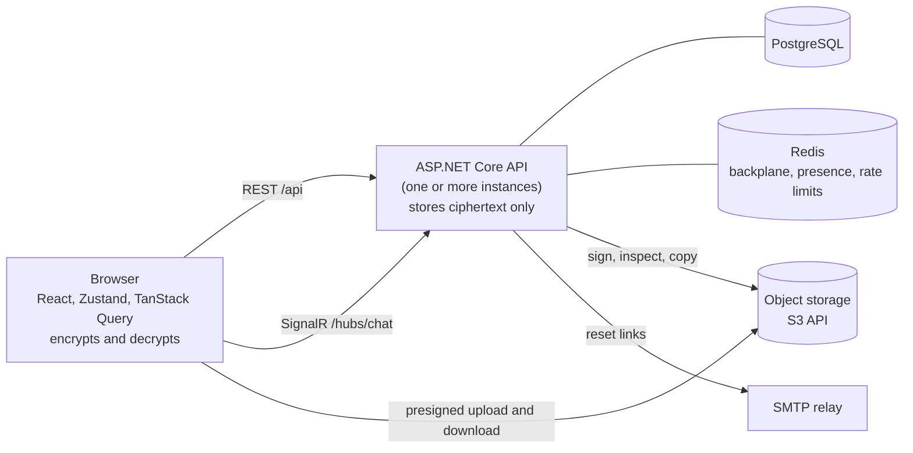

# ChatNET

[](https://github.com/Harsh-Moriya/chatnet/actions/workflows/ci.yml)

A real-time, multi-user chat application with direct (1:1) and group conversations. The backend is **ASP.NET Core (.NET 10)** with **SignalR**, the frontend is **React 19 and TypeScript**, data is in **PostgreSQL**, and **Redis** carries live state between server instances. Messages and files are **end-to-end encrypted**: they are encrypted in the browser, and the server stores and relays ciphertext it cannot read.

## Features

- **End-to-end encryption.** The text and files of every message, in direct chats and groups, are encrypted in the browser and opened only by the members' browsers. Each person's keys are made in the browser, kept on each of their devices and in a backup that only their recovery passphrase opens. A conversation's key is replaced whenever its members change and at least weekly, a new device is linked with a code or a QR code, a lost device can be cut off, and people can compare safety numbers to be sure of each other. The server still sees who talks to whom and when. It protects against a leaked database, bucket or backup and a curious operator of the storage; it cannot protect against a server that serves changed code. See [encryption keys and devices](docs/features/encryption-keys.md).
- **Conversations.** Direct chats and groups on one model. Groups have an owner, admins and members; people can be added, removed, promoted and can leave, and the owner role is handed on automatically.
- **Live messaging.** Messages, typing indicators, read receipts ("Seen"), unread counts and online presence arrive over SignalR, correctly across several server instances.
- **Reliable history.** Cursor-paged history, gap-free catch-up after a reconnect, and sends that are safe to retry: a message is stored once however many times the request arrives.
- **Search.** Search your messages by words in any order, `"exact phrase"`, `-word` and `a or b`. It runs in the browser over a copy of the messages the device has read, kept current by a per-conversation changes feed.
- **Edit and delete.** Edit your own message for 15 minutes; delete at any time (group owners and admins can delete anyone's). Everyone sees the change live.
- **Files and pictures.** Up to four files per message, encrypted in the browser and uploaded straight to S3-compatible object storage, so the bucket holds ciphertext. Profile and group pictures.
- **Notifications.** `@mentions`, group invitations, a bell with an unread count, browser alerts, per-conversation mute, and optional Web Push alerts while the app is closed, which say who wrote and never what.
- **Sessions.** Short-lived access tokens with rotating refresh tokens in an httpOnly cookie, and sign-out that ends the session.
- **Account recovery.** A forgotten password is reset by email with a single-use link that expires. The server answers the same for every address, and a reset ends every session of the account. A reset does not recover encrypted history: the recovery passphrase or a signed-in device does.
- **Delivery that survives failures.** Every push is recorded with the change that causes it (a transactional outbox), so a message saved while Redis was down is still delivered.
- **Limits that hold across servers.** Rate limits are counted in Redis, so several API instances apply one limit between them.
- **Observability.** Structured logs and OpenTelemetry traces that carry ids, never message content.

See [docs/features](docs/features/README.md) for each feature in detail.

## How it fits together



REST loads data and performs every change that must be confirmed. SignalR only pushes events. The API is organised as vertical slices (one folder per feature, with its endpoint, MediatR handler, validator and data access). Every message, file and conversation key is sealed in the browser, and the server never holds a key that opens one: the formats are specified in [encryption formats](docs/architecture/encryption-format.md) and the protections and their limits in the [security model](docs/architecture/security-model.md). Read the [architecture overview](docs/architecture/overview.md), then the [real-time design](docs/architecture/real-time.md).

## Tech stack

| Layer | Technology |
|---|---|
| Frontend | React 19, TypeScript, Vite, Tailwind CSS 4, Zustand, TanStack Query, React Router, `@microsoft/signalr` |
| Backend | ASP.NET Core on .NET 10 (Minimal API and SignalR), MediatR, FluentValidation, EF Core 10 |
| Database | PostgreSQL 16 |
| Live state | SignalR with a Redis 7 backplane; presence and rate-limit counters in Redis |
| Auth | ASP.NET Core Identity, JWT access tokens, rotating refresh tokens |
| Encryption | Web Crypto in the browser: X25519 and Ed25519 keys, AES-256-GCM, HKDF-SHA256 and PBKDF2; IndexedDB for the keys and a local copy of messages |
| Files | Any S3-compatible bucket through the S3 API (designed for Cloudflare R2; RustFS locally) |
| Observability | Serilog, OpenTelemetry, Jaeger |
| Tests | xUnit, `WebApplicationFactory`, Testcontainers; Vitest |
| Packaging | Docker, Docker Compose, Caddy |

## Quick start

You need the [.NET 10 SDK](https://dotnet.microsoft.com/download), a current [Node.js](https://nodejs.org) LTS, [Docker](https://www.docker.com/products/docker-desktop), and the EF Core CLI (`dotnet tool install --global dotnet-ef`).

**1. Infrastructure.** Copy `.env.example` to `.env`, fill in the values (the file explains them), and start Postgres, Redis, object storage, Jaeger, Adminer and a local mail catcher (Mailpit):

```bash
cp .env.example .env
docker-compose up -d
```

**2. Backend.** Secrets go in user-secrets, never in a committed file:

```bash
cd backend/ChatNET.API
dotnet user-secrets set "ConnectionStrings:DefaultConnection" "Host=localhost;Port=5432;Database=chatnet;Username=chatnet_user;Password=<POSTGRES_PASSWORD from .env>"
dotnet user-secrets set "ConnectionStrings:Redis" "localhost:6379"
dotnet user-secrets set "Jwt:SigningKey" "$(openssl rand -base64 32)"
dotnet user-secrets set "Storage:ServiceUrl" "http://localhost:9000"
dotnet user-secrets set "Storage:Bucket" "<STORAGE_BUCKET from .env>"
dotnet user-secrets set "Storage:AccessKey" "<RUSTFS_ACCESS_KEY from .env>"
dotnet user-secrets set "Storage:SecretKey" "<RUSTFS_SECRET_KEY from .env>"
dotnet ef database update
dotnet run
```

The API listens on `http://localhost:5045`, and in Development serves its OpenAPI document at `/openapi/v1.json` and an API reference at `/scalar/v1`.

**3. Frontend** (in a second terminal).

```bash
cd frontend
npm install
npm run dev
```

Open `http://localhost:5173`. Vite proxies `/api` and `/hubs` to the backend.

The first time a person signs in they choose a **recovery passphrase** (at least 12 characters), and the browser makes their keys. Two people can only chat once each has set up keys, so to try the app as two people, register and set up in two different browser origins (`localhost` and `127.0.0.1`). The browser needs Web Crypto with X25519 and Ed25519 (Chrome 137, Firefox 130, Safari 17 or later), IndexedDB and a secure context (`https`, or `localhost`).

[Running locally](docs/operations/running-locally.md) covers password reset emails, optional push alerts, traces and trying the app as two people at once.

## Tests

Backend tests run the real API in-process against real Postgres, Redis and object storage in throwaway containers, so Docker must be running. Frontend tests are logic tests in Node.

```bash
dotnet test
cd frontend && npm test
```

GitHub Actions runs both on every push, together with the frontend lint and build and a dependency vulnerability check.

## Documentation

| | |
|---|---|
| [Architecture](docs/architecture/overview.md) | System overview, [request flow](docs/architecture/request-flow.md), [real-time design](docs/architecture/real-time.md), [data model](docs/architecture/data-model.md), [security model](docs/architecture/security-model.md), [encryption formats](docs/architecture/encryption-format.md) |
| Encryption | [Keys and devices](docs/features/encryption-keys.md), [conversation keys](docs/features/conversation-keys.md), [safety numbers](docs/features/safety-numbers.md) |
| [Features](docs/features/README.md) | One page per feature, with behaviour, endpoints, events and limits |
| [API](docs/api/endpoints.md) | [Endpoints](docs/api/endpoints.md), [errors](docs/api/errors.md), [real-time events](docs/api/realtime-events.md) |
| [Operations](docs/operations/running-locally.md) | [Configuration](docs/operations/configuration.md), [deployment](docs/operations/deployment.md), [backups](docs/operations/backups.md), [observability](docs/operations/observability.md) |
| [Decisions](docs/decisions/README.md) | Architecture decision records: why it is built this way |
