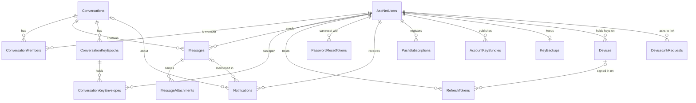

# Data model

PostgreSQL 16 through EF Core 10. The schema below is read from a database built by the migrations in `backend/ChatNET.API/Migrations`. Besides the tables listed here, ASP.NET Identity's own tables (`AspNetRoles`, `AspNetUserClaims`, `AspNetUserLogins`, `AspNetUserRoles`, `AspNetUserTokens`, `AspNetRoleClaims`) exist; the application does not use roles, claims or external logins.

`OutboxMessages` has no foreign keys: a row names the things it concerns inside its payload.

## Conventions

- **Keys** are UUIDs. Messages, conversations and notifications get a time-ordered UUID (version 7) made by the application; the column default `gen_random_uuid()` is only a fallback.
- **Timestamps** are `timestamp with time zone`, stored and returned in UTC.
- **Enums** are stored as text (`Direct`, `Group`, `Owner`, `Admin`, `Member`, `Image`, `Video`, `File`, `Mention`, `MemberAdded`), so a query against the database is readable.
- **Soft delete.** Messages and users are never removed. A deleted message keeps its row with `Content` set to null; a deactivated user keeps their account with `IsDeactivated`.
- **Integrity in the database.** Every unique or integrity rule is enforced by an index or constraint as well as in code, and a race is settled by catching the specific violation.
- **Indexes** exist for queries that exist. Query-cost tests ask Postgres how many rows the real query reads.

## AspNetUsers

The Identity user table, extended with ChatNET's own columns.

| Column | Type | Notes |
|---|---|---|
| `Id` | uuid | primary key |
| `DisplayName` | text | 1 to 100 characters, set by the user |
| `AvatarKey` | text, null | object key of the profile picture in the bucket |
| `LastSeenAt` | timestamptz, null | written when the user goes offline |
| `IsDeactivated`, `DeactivatedAt` | boolean, timestamptz null | a deactivated account cannot sign in or send |
| `UserName` (`NormalizedUserName`) | varchar(256) | the handle used in `@mentions`; unique |
| `Email` (`NormalizedEmail`) | varchar(256) | unique through `EmailIndex` |
| `PasswordHash`, `SecurityStamp`, `ConcurrencyStamp`, `LockoutEnd`, `LockoutEnabled`, `AccessFailedCount` | Identity | lockout after five failures |
| `EmailConfirmed`, `PhoneNumber`, `PhoneNumberConfirmed`, `TwoFactorEnabled` | Identity | present and unused |

Indexes: `UserNameIndex` (unique), `EmailIndex` (unique), and two trigram GIN indexes on `DisplayName` and `UserName` (extension `pg_trgm`) that serve the people search.

## Conversations

One table for both kinds.

| Column | Type | Notes |
|---|---|---|
| `Id` | uuid | primary key |
| `Type` | text | `Direct` or `Group` |
| `Name` | text, null | groups only |
| `AvatarKey` | text, null | groups only |
| `DirectKey` | text, null | for a direct chat, the two user ids sorted and joined (`idA:idB`), so both participants produce the same key |
| `CreatedAt`, `UpdatedAt` | timestamptz | `UpdatedAt` moves when a message is sent, which orders the list |
| `CreatedById` | uuid | foreign key to the creator |
| `KeyEpoch` | integer | the newest key epoch, 0 for a conversation that has none. Starts at 1 for every conversation made now |
| `KeyRotationRequired` | boolean | someone left since the epoch in force was made, so it is due for replacement. Set with the removal, cleared when the next epoch is stored |

Indexes and constraints: a **unique partial index** on `DirectKey` where it is not null (at most one direct chat per pair of users, whatever the interleaving of requests); a check that a direct conversation has a `DirectKey`; a check that `KeyEpoch` is not negative; `IX_Conversations_UpdatedAt` descending. The id of a conversation is chosen by the browser that creates it, so that the first epoch can be made for it.

## ConversationMembers

Primary key `(ConversationId, UserId)`; index on `UserId`.

| Column | Type | Notes |
|---|---|---|
| `Role` | text | `Owner`, `Admin` or `Member`; one owner per group |
| `JoinedAt` | timestamptz | history starts here for this member |
| `LeftAt` | timestamptz, null | history ends here; the row stays so the conversation remains readable |
| `LastReadAt` | timestamptz, null | the member has seen every message sent at or before this time; only moves forward |
| `IsMuted` | boolean | the member's own choice |

Someone added again after leaving reuses their row: `JoinedAt` is reset, `LeftAt` cleared, and they see only what is said from the new join.

## Messages

| Column | Type | Notes |
|---|---|---|
| `Id` | uuid | primary key |
| `ConversationId`, `SenderId` | uuid | foreign keys; cascade on the conversation |
| `Content` | text, null | at most 4,000 UTF-16 code units; null for a deleted message |
| `CreatedAt` | timestamptz | set by the server; with `Id` it orders messages |
| `EditCount`, `EditedAt` | integer, timestamptz null | |
| `IsDeleted`, `DeletedAt`, `DeletedById` | boolean, timestamptz null, uuid null | who deleted it: the sender, or a group owner or admin |
| `ClientMessageId` | uuid, null | the id the browser made up for the send, for idempotency |

Indexes:

- `IX_Messages_ConversationId_CreatedAt` on `(ConversationId, CreatedAt DESC)`: every history query walks this index from a cursor and stops after 50 rows.
- `IX_Messages_ConversationId_SenderId_ClientMessageId`: **unique and partial** (where `ClientMessageId` is not null). Concurrent copies of one send are settled by this index.
- `IX_Messages_Search`: a GIN index on `(ConversationId, to_tsvector('simple', coalesce(Content, '')))`, using `btree_gin`, for message search.
- Indexes on `SenderId` and `DeletedById` for the foreign keys.

## MessageAttachments

| Column | Type | Notes |
|---|---|---|
| `Id` | uuid | primary key |
| `MessageId` | uuid | foreign key, cascade; indexed |
| `StorageKey` | text | `attachments/{conversationId}/{attachmentId}` in the bucket |
| `Type` | text | `Image`, `Video` or `File` |
| `ContentType` | text | the type the bucket stored |
| `FileName` | text | cleaned: path parts and control characters removed, at most 255 characters |
| `FileSizeBytes` | bigint | |
| `CreatedAt` | timestamptz | |

The table stores keys, never links. A link is signed for the reader each time it is sent.

## RefreshTokens

| Column | Type | Notes |
|---|---|---|
| `Id` | uuid | primary key |
| `UserId` | uuid | foreign key, cascade |
| `FamilyId` | uuid | every token issued from one sign-in shares it |
| `TokenHash` | text | SHA-256 of the token; unique. The token itself is never stored |
| `CreatedAt`, `ExpiresAt` | timestamptz | |
| `RevokedAt` | timestamptz, null | set when the token is replaced or its family is revoked |
| `ReplacedById` | uuid, null | the token that replaced this one |
| `DeviceId` | uuid, null | foreign key to `Devices`, set null on delete. The device the session is signed in on, once a sign-in or renewal names one; every token of the family carries it |

Indexes on `TokenHash` (unique), `FamilyId`, `UserId`, `ExpiresAt` and `DeviceId`.

## PasswordResetTokens

| Column | Type | Notes |
|---|---|---|
| `Id` | uuid | primary key |
| `UserId` | uuid | foreign key, cascade |
| `TokenHash` | text | SHA-256 of the token; unique. The token itself is never stored |
| `CreatedAt`, `ExpiresAt` | timestamptz | a link is usable while the time is before `ExpiresAt` (30 minutes after it was made, by default) |
| `UsedAt` | timestamptz, null | set when the link is used, or voided by a reset made with another link |

Indexes on `TokenHash` (unique), `UserId` and `ExpiresAt`. Using a link is one conditional `UPDATE ... WHERE "UsedAt" IS NULL AND "ExpiresAt" > now RETURNING "UserId"`. A daily job removes rows that expired more than a week ago.

## AccountKeyBundles

| Column | Type | Notes |
|---|---|---|
| `UserId` | uuid | foreign key, cascade; part of the primary key |
| `Generation` | integer | part of the primary key. 1 for the first keys; a later generation is made when a device is removed |
| `Bundle` | bytea | the 134 byte signed public bundle, as the browser made it (see [encryption formats](encryption-format.md)) |
| `CreatedAt` | timestamptz | |

The primary key `(UserId, Generation)` is what makes a second set-up a conflict: the first insert waits for one that is running and does nothing if it committed.

## KeyBackups

| Column | Type | Notes |
|---|---|---|
| `UserId` | uuid | primary key, foreign key, cascade |
| `Blob` | bytea | the private keys encrypted under a key stretched from the passphrase of the person. The server cannot open it |
| `Version` | integer | 1 at set-up, +1 for each replacement. A replacement names the version it was made from, in one conditional `UPDATE` |
| `UpdatedAt` | timestamptz | |

## Devices

| Column | Type | Notes |
|---|---|---|
| `Id` | uuid | primary key, made by the application |
| `UserId` | uuid | foreign key, cascade |
| `Kind` | varchar(16) | `Web`, `Ios` or `Android` |
| `Name` | varchar(100) | what the person sees in their list ("Chrome on Windows"); chosen by the device |
| `CreatedAt`, `LastActiveAt` | timestamptz | `LastActiveAt` moves when a session tied to the device signs in or is renewed |
| `RemovedAt` | timestamptz, null | set when the device is removed. The row stays, so a removed device can find out |

Index on `UserId`. Adding a device counts the person's devices that are not removed and inserts, in one transaction behind a lock on the person.

## DeviceLinkRequests

| Column | Type | Notes |
|---|---|---|
| `Id` | uuid | primary key, made by the application |
| `UserId` | uuid | foreign key, cascade |
| `Code` | varchar(10) | the code the new device shows; unique per person |
| `TemporaryPublicKey` | bytea | the 32 byte one-time key the secrets are sealed to |
| `Kind`, `Name` | varchar | what the new device calls itself, shown on the device that approves |
| `Payload` | bytea, null | the sealed secrets, set on approval and cleared when collected |
| `CreatedAt`, `ExpiresAt` | timestamptz | `ExpiresAt` is 10 minutes after `CreatedAt` by default, in whole seconds |
| `ApprovedAt`, `CollectedAt` | timestamptz, null | |

Indexes on `(UserId, Code)` (unique) and `ExpiresAt`. Approving is one conditional `UPDATE` (still waiting, not expired). Collecting is one `UPDATE ... RETURNING` that clears the payload. Requests that expired more than an hour ago are removed when their person opens a new one.

## ConversationKeyEpochs

One row per key period of a conversation. The key is never here: it reaches each member in an envelope.

| Column | Type | Notes |
|---|---|---|
| `ConversationId` | uuid | foreign key, cascade; part of the primary key |
| `Epoch` | integer | part of the primary key, at least 1. The primary key is also what stops two requests from both storing "the next epoch" |
| `CreatedById` | uuid | foreign key to the member who made it |
| `Reason` | text | `Created` (the first key of a conversation), `MemberAdded` (people joined) or `Rotated` (any other replacement) |
| `CreatedAt` | timestamptz | |
| `KeyCommitment` | bytea | 32 bytes: a hash of the key bound to the conversation and the epoch. It reveals nothing about the key |
| `Signature` | bytea | 64 bytes: the creator's signature over the record of the epoch (see [encryption formats](encryption-format.md)) |

Storing an epoch is one transaction, behind the conversation's advisory lock: the epoch, its envelopes, the new `KeyEpoch` and `KeyRotationRequired = false` on the conversation. A conversation and a membership change save their epoch in the same transaction as themselves.

## ConversationKeyEnvelopes

| Column | Type | Notes |
|---|---|---|
| `ConversationId`, `Epoch` | uuid, integer | foreign key to `ConversationKeyEpochs`, cascade; with `UserId` the primary key |
| `UserId` | uuid | the member the key is sealed for. Foreign key, restrict |
| `AccountKeyGeneration` | integer | the generation of the member's account key the envelope is sealed to, at least 1 |
| `Envelope` | bytea | 94 bytes: the epoch key sealed to that key |

The members of an epoch are the users it has an envelope for, so there is no separate member list. Index on `(ConversationId, UserId, Epoch)` for "my envelopes in this conversation". A member is only ever given the row with their own `UserId`.

## Notifications

Rows exist for mentions and for being added to a group. New messages are not notification rows; they are counted as unread.

| Column | Type | Notes |
|---|---|---|
| `Id` | uuid | primary key |
| `UserId` | uuid | the recipient; cascade |
| `ActorId` | uuid | who caused it |
| `ConversationId`, `MessageId` | uuid, null | `ON DELETE SET NULL` |
| `Type` | text | `Mention` or `MemberAdded` (the types the application creates) |
| `IsRead` | boolean | |
| `CreatedAt` | timestamptz | |

Index `(UserId, IsRead, CreatedAt DESC)` serves the list, which reads two ordered walks (unread and read) and merges them.

## OutboxMessages

| Column | Type | Notes |
|---|---|---|
| `Id` | uuid | primary key |
| `Kind` | varchar(64) | the event name, for example `MessageCreated` |
| `Payload` | jsonb | ids only |
| `CreatedAt`, `NextAttemptAt` | timestamptz | |
| `DispatchedAt` | timestamptz, null | set when delivered |
| `Attempts` | integer | |
| `LastError` | varchar(500), null | exception type and a count, never content |

Two partial indexes: by `CreatedAt` where `DispatchedAt` is null (the relay's queue) and by `DispatchedAt` where it is not null (the clean-up).

## PushSubscriptions

| Column | Type | Notes |
|---|---|---|
| `Id` | uuid | primary key |
| `UserId` | uuid | foreign key, cascade |
| `Endpoint` | varchar(2048) | the push service address; unique; treated as a secret |
| `P256dh`, `Auth` | varchar(128), varchar(64) | the browser's public key and auth secret |
| `CreatedAt`, `LastUsedAt` | timestamptz | |

One row per browser. A browser registered to one person moves to whoever registers it next.

## Extensions

The migrations create `btree_gin` and `pg_trgm`. Both ship with Postgres and are trusted extensions, so the owner of the database can create them.
