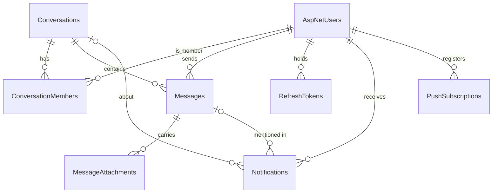

# Data model

PostgreSQL 16 through EF Core 10. The schema below is read from a database built by the migrations in `backend/ChatNET.API/Migrations`. Besides the tables listed here, ASP.NET Identity's own tables (`AspNetRoles`, `AspNetUserClaims`, `AspNetUserLogins`, `AspNetUserRoles`, `AspNetUserTokens`, `AspNetRoleClaims`) exist; the application does not use roles, claims or external logins.

`OutboxMessages` has no foreign keys: a row names the things it concerns inside its payload.

## Conventions

- **Keys** are UUIDs. Messages, conversations and notifications get a time-ordered UUID (version 7) made by the application; the column default `gen_random_uuid()` is only a fallback.
- **Timestamps** are `timestamp with time zone`, stored and returned in UTC.
- **Enums** are stored as text (`Direct`, `Group`, `Owner`, `Admin`, `Member`, `Image`, `Video`, `File`, `Mention`, `MemberAdded`), so a query against the database is readable.
- **Soft delete.** Messages and users are never removed. A deleted message keeps its row with `Content` set to null; a deactivated user keeps their account with `IsDeactivated`.
- **Integrity in the database.** Every unique or integrity rule is enforced by an index or constraint as well as in code, and a race is settled by catching the specific violation.
- **Indexes** exist for queries that exist. Query-cost tests ask Postgres how many rows the real query reads.

## AspNetUsers

The Identity user table, extended with ChatNET's own columns.

| Column | Type | Notes |
|---|---|---|
| `Id` | uuid | primary key |
| `DisplayName` | text | 1 to 100 characters, set by the user |
| `AvatarKey` | text, null | object key of the profile picture in the bucket |
| `LastSeenAt` | timestamptz, null | written when the user goes offline |
| `IsDeactivated`, `DeactivatedAt` | boolean, timestamptz null | a deactivated account cannot sign in or send |
| `UserName` (`NormalizedUserName`) | varchar(256) | the handle used in `@mentions`; unique |
| `Email` (`NormalizedEmail`) | varchar(256) | unique through `EmailIndex` |
| `PasswordHash`, `SecurityStamp`, `ConcurrencyStamp`, `LockoutEnd`, `LockoutEnabled`, `AccessFailedCount` | Identity | lockout after five failures |
| `EmailConfirmed`, `PhoneNumber`, `PhoneNumberConfirmed`, `TwoFactorEnabled` | Identity | present and unused |

Indexes: `UserNameIndex` (unique), `EmailIndex` (unique), and two trigram GIN indexes on `DisplayName` and `UserName` (extension `pg_trgm`) that serve the people search.

## Conversations

One table for both kinds.

| Column | Type | Notes |
|---|---|---|
| `Id` | uuid | primary key |
| `Type` | text | `Direct` or `Group` |
| `Name` | text, null | groups only |
| `AvatarKey` | text, null | groups only |
| `DirectKey` | text, null | for a direct chat, the two user ids sorted and joined (`idA:idB`), so both participants produce the same key |
| `CreatedAt`, `UpdatedAt` | timestamptz | `UpdatedAt` moves when a message is sent, which orders the list |
| `CreatedById` | uuid | foreign key to the creator |

Indexes and constraints: a **unique partial index** on `DirectKey` where it is not null (at most one direct chat per pair of users, whatever the interleaving of requests); a check that a direct conversation has a `DirectKey`; `IX_Conversations_UpdatedAt` descending.

## ConversationMembers

Primary key `(ConversationId, UserId)`; index on `UserId`.

| Column | Type | Notes |
|---|---|---|
| `Role` | text | `Owner`, `Admin` or `Member`; one owner per group |
| `JoinedAt` | timestamptz | history starts here for this member |
| `LeftAt` | timestamptz, null | history ends here; the row stays so the conversation remains readable |
| `LastReadAt` | timestamptz, null | the member has seen every message sent at or before this time; only moves forward |
| `IsMuted` | boolean | the member's own choice |

Someone added again after leaving reuses their row: `JoinedAt` is reset, `LeftAt` cleared, and they see only what is said from the new join.

## Messages

| Column | Type | Notes |
|---|---|---|
| `Id` | uuid | primary key |
| `ConversationId`, `SenderId` | uuid | foreign keys; cascade on the conversation |
| `Content` | text, null | at most 4,000 UTF-16 code units; null for a deleted message |
| `CreatedAt` | timestamptz | set by the server; with `Id` it orders messages |
| `EditCount`, `EditedAt` | integer, timestamptz null | |
| `IsDeleted`, `DeletedAt`, `DeletedById` | boolean, timestamptz null, uuid null | who deleted it: the sender, or a group owner or admin |
| `ClientMessageId` | uuid, null | the id the browser made up for the send, for idempotency |

Indexes:

- `IX_Messages_ConversationId_CreatedAt` on `(ConversationId, CreatedAt DESC)`: every history query walks this index from a cursor and stops after 50 rows.
- `IX_Messages_ConversationId_SenderId_ClientMessageId`: **unique and partial** (where `ClientMessageId` is not null). Concurrent copies of one send are settled by this index.
- `IX_Messages_Search`: a GIN index on `(ConversationId, to_tsvector('simple', coalesce(Content, '')))`, using `btree_gin`, for message search.
- Indexes on `SenderId` and `DeletedById` for the foreign keys.

## MessageAttachments

| Column | Type | Notes |
|---|---|---|
| `Id` | uuid | primary key |
| `MessageId` | uuid | foreign key, cascade; indexed |
| `StorageKey` | text | `attachments/{conversationId}/{attachmentId}` in the bucket |
| `Type` | text | `Image`, `Video` or `File` |
| `ContentType` | text | the type the bucket stored |
| `FileName` | text | cleaned: path parts and control characters removed, at most 255 characters |
| `FileSizeBytes` | bigint | |
| `CreatedAt` | timestamptz | |

The table stores keys, never links. A link is signed for the reader each time it is sent.

## RefreshTokens

| Column | Type | Notes |
|---|---|---|
| `Id` | uuid | primary key |
| `UserId` | uuid | foreign key, cascade |
| `FamilyId` | uuid | every token issued from one sign-in shares it |
| `TokenHash` | text | SHA-256 of the token; unique. The token itself is never stored |
| `CreatedAt`, `ExpiresAt` | timestamptz | |
| `RevokedAt` | timestamptz, null | set when the token is replaced or its family is revoked |
| `ReplacedById` | uuid, null | the token that replaced this one |

Indexes on `TokenHash` (unique), `FamilyId`, `UserId` and `ExpiresAt`.

## Notifications

Rows exist for mentions and for being added to a group. New messages are not notification rows; they are counted as unread.

| Column | Type | Notes |
|---|---|---|
| `Id` | uuid | primary key |
| `UserId` | uuid | the recipient; cascade |
| `ActorId` | uuid | who caused it |
| `ConversationId`, `MessageId` | uuid, null | `ON DELETE SET NULL` |
| `Type` | text | `Mention` or `MemberAdded` (the types the application creates) |
| `IsRead` | boolean | |
| `CreatedAt` | timestamptz | |

Index `(UserId, IsRead, CreatedAt DESC)` serves the list, which reads two ordered walks (unread and read) and merges them.

## OutboxMessages

| Column | Type | Notes |
|---|---|---|
| `Id` | uuid | primary key |
| `Kind` | varchar(64) | the event name, for example `MessageCreated` |
| `Payload` | jsonb | ids only |
| `CreatedAt`, `NextAttemptAt` | timestamptz | |
| `DispatchedAt` | timestamptz, null | set when delivered |
| `Attempts` | integer | |
| `LastError` | varchar(500), null | exception type and a count, never content |

Two partial indexes: by `CreatedAt` where `DispatchedAt` is null (the relay's queue) and by `DispatchedAt` where it is not null (the clean-up).

## PushSubscriptions

| Column | Type | Notes |
|---|---|---|
| `Id` | uuid | primary key |
| `UserId` | uuid | foreign key, cascade |
| `Endpoint` | varchar(2048) | the push service address; unique; treated as a secret |
| `P256dh`, `Auth` | varchar(128), varchar(64) | the browser's public key and auth secret |
| `CreatedAt`, `LastUsedAt` | timestamptz | |

One row per browser. A browser registered to one person moves to whoever registers it next.

## Extensions

The migrations create `btree_gin` and `pg_trgm`. Both ship with Postgres and are trusted extensions, so the owner of the database can create them.
