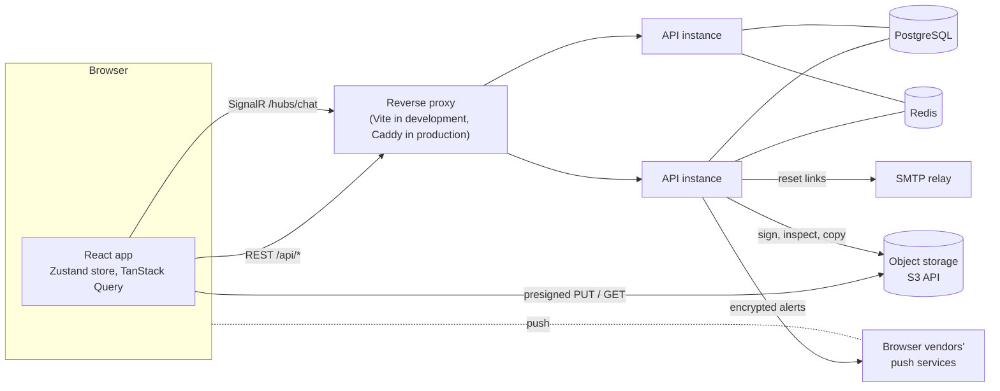

# Architecture overview

ChatNET is a React single-page application talking to an ASP.NET Core API over two channels: REST for loading data and confirming changes, and SignalR (WebSockets) for pushing live updates. PostgreSQL holds the data, Redis holds shared live state, and an S3-compatible bucket holds files.



## The two channels

- **REST** loads data (conversations, history) and performs every change that must be confirmed (sign in, send a message, edit, add a member).
- **SignalR** only pushes events to connected clients. Clients never send messages or fetch history through the hub. The hub accepts three calls (join a conversation, start and stop typing).

The browser follows the same split: TanStack Query owns REST data, and hub events patch the Zustand store directly. A hub event never triggers a refetch.

## What each piece does

| Piece | Role |
|---|---|
| ASP.NET Core API | Minimal API endpoints and one SignalR hub. Stateless, so several instances run side by side. |
| MediatR | Routes each endpoint or hub call to one handler. A validation behaviour runs first, and a tracing behaviour wraps both. |
| PostgreSQL 16 | All durable data. EF Core 10 with the Npgsql provider; a few hand-written SQL queries where LINQ cannot express an efficient plan. |
| Redis 7 | The SignalR backplane, who is online, the rate-limit counters, and a channel that evicts connections. Nothing in Redis is the only copy of anything that matters. |
| Object storage | Attachments and pictures. Designed for Cloudflare R2 (the S3 API is the contract); RustFS locally and in tests. The browser uploads straight to it with presigned links. |
| Outbox and relay | A push that follows a change is recorded in the same transaction as the change, so it is delivered even if the request fails after the commit. See [real-time design](real-time.md). |
| Encryption keys | Made in the browser (X25519, Ed25519 and AES-256-GCM on WebCrypto). The server stores public bundles, an encrypted backup, devices and the sealed key of each epoch of each conversation, and opens none of it. The text of every message is sealed with them in the sender's browser and opened only in the members' browsers; files are stored as uploaded. See [conversation keys](../features/conversation-keys.md) and [messaging](../features/messaging.md). |
| Web Push | Alerts for people with no live connection, encrypted to the browser (RFC 8291) and signed with VAPID (RFC 8292). Optional: off unless the server is given keys. |
| Email | Password reset links are sent through an SMTP relay (MailKit): a mail catcher locally, a provider in production. The relay job sends them, so a request never waits for a mail server. Optional: off unless `Email:Smtp:Host` is set. |

## Code organisation

The backend is organised as **vertical slices**: a feature owns its endpoint, command or query, validator, handler and data access in one folder, instead of spreading across technical layers.

```
backend/ChatNET.API/
  Auth/            registration, login, refresh tokens, password reset, JWT
  Email/           the SMTP sender
  Users/           profile, user search
  Conversations/   direct and group conversations, membership, read state, mute, the keys of each conversation
  Keys/            public key bundles, encrypted backups, the lookup of other people's keys
  Devices/         the devices that hold a person's keys, and linking a new one
  Messaging/       sending, history, edit, delete, the SignalR hub
  Media/           upload tickets, attachments, pictures, object storage
  Notifications/   mentions and invitations, the list behind the bell
  Presence/        who is online, connection registry and eviction
  Push/            Web Push registration, encryption, sending
  Outbox/          the outbox table, the publisher, the relay
  RateLimiting/    the Redis sliding-window limiter and its policies
  Common/          behaviours, exceptions, health, hosting, logging, observability
frontend/src/
  features/        auth, chat, encryption, notifications, presence, profile, push (one folder each)
  components/ui/   shared primitives (Button, Input, FormField, Menu)
  lib/             API client, query client, the encryption formats (lib/crypto)
```

Inside a feature the flow is always endpoint, command or query, validator, handler, repository. Endpoints contain no logic.

## Technology

| Layer | Technology |
|---|---|
| Frontend | React 19, TypeScript, Vite, Tailwind CSS 4, React Router, Zustand, TanStack Query, axios, `@microsoft/signalr` |
| Backend | ASP.NET Core on .NET 10 (Minimal API and SignalR), MediatR, FluentValidation, EF Core 10 |
| Auth | ASP.NET Core Identity (`AddIdentityCore`), JWT access token, rotating refresh token in an httpOnly cookie |
| Data | PostgreSQL 16, Redis 7 |
| Files | S3-compatible storage through AWSSDK.S3 |
| Observability | Serilog, OpenTelemetry (Jaeger locally) |
| Tests | xUnit, `WebApplicationFactory`, Testcontainers (real Postgres, Redis and object storage), Vitest |
| Packaging | Docker, Docker Compose, Caddy in front of the API in the production file |

## Further reading

- [Request flow](request-flow.md): the middleware pipeline and the path of one request.
- [Real-time design](real-time.md): groups, the backplane, the outbox, presence, eviction.
- [Data model](data-model.md): tables, columns and indexes.
- [Security model](security-model.md).
- [Decision records](../decisions/README.md): why the main choices were made.
