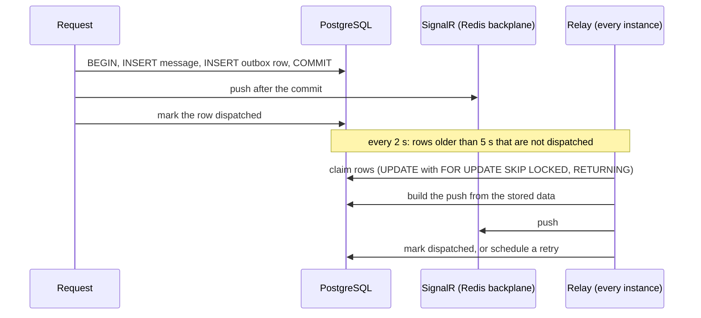

# Real-time design

Live behaviour rests on four mechanisms: SignalR groups, the Redis backplane, the transactional outbox, and presence in Redis. This page explains each and how they fit.

## The hub

- The hub is at `/hubs/chat`, uses the JSON protocol, and requires a valid access token. Browsers cannot set headers on a WebSocket upgrade, so the client passes the token as `?access_token=`. The server accepts that only on `/hubs/chat`.
- The hub closes a connection when its access token expires; the client reconnects with a renewed token.
- The user id is read from the token's `sub` claim, so sending "to user X" reaches every open tab of X.
- Hub payloads use the same JSON conventions as REST (camelCase, enums as strings).

### Groups

SignalR groups are not stored anywhere and vanish when a connection closes. On every connect and reconnect the hub puts the connection into one group per conversation the user is an active member of (`conv:{conversationId}`). `JoinConversation(id)` covers a conversation created while the user is already connected; it checks membership first and gives the same refusal for an unknown conversation and one that belongs to someone else.

### Typing

Typing indicators are ephemeral: no database and no MediatR. A connection can send typing only for conversations it has joined, which is tracked in the connection's own state, so the check costs no query. At most one `UserTyping` start event per second per conversation per connection is delivered; the extra calls succeed and are dropped. The displayed name comes from the token.

## The backplane

With several API instances, a group send on one instance must reach connections held by another. The SignalR Redis backplane (channel prefix `chatnet`) does that: the sending instance publishes to Redis and every instance delivers to the connections it holds.

## The transactional outbox

A message is saved, then pushed. If the process dies between the two, or Redis is down at that moment, the push is lost and connected clients never see the message until they reload. The outbox removes that gap.

- A change and its outbox row are saved in the **same transaction**. A row records what happened by id (`MessageCreated(messageId, conversationId)`), not the payload. The relay builds the push from the stored data when it makes it, so a late push of an edited or deleted message carries no text it should not.
- The request pushes right after the commit and marks the row. That is the fast path.
- The relay runs on every instance every 2 seconds. It takes rows that are at least 5 seconds old and not dispatched, oldest first, in batches of 100. One statement, an `UPDATE` over a subquery that uses `FOR UPDATE SKIP LOCKED` and returns the rows, chooses and holds them and schedules their retry at the same time, so two relays never take the same row.
- A failed attempt is retried after a delay that starts at 5 seconds and doubles per attempt, up to 64 times the base. After 10 attempts the relay gives up on the row: it keeps its last error (the exception type and a count only, no content) and is not tried again.
- A clean-up pass removes rows once they are a day old, both dispatched rows and rows that were given up on. Until then a given-up row stays in the table for inspection. A row that is still being retried is never removed.
- Delivery is **at least once**. Receivers merge by id, so a repeated push is harmless.
- Only cancellation of the token a pass was given ends it. A push, storage call or table read that times out is a failed attempt, never the end of the relay.

### What goes through the outbox

| Kind | What the relay does |
|---|---|
| `MessageCreated` | pushes `ReceiveMessage` to the conversation's group |
| `MessageUpdated` | pushes `MessageUpdated` (an edit or a deletion) to the group |
| `MessageFilesRemoved` | removes a deleted message's files from the bucket (not a push) |
| `NotificationCreated` | pushes `NotificationReceived` to the recipient's tabs |
| `MessageAlertRequested`, `NotificationAlertRequested` | sends Web Push alerts to people with no live connection |
| `ConversationCreated` | pushes `AddedToConversation` for a new conversation |
| `MembersJoined` | pushes `AddedToConversation` to people added to a group or returning to it |
| `MembersChanged` | pushes `MembersChanged` to the people in the group |
| `MemberLeft` | pushes `RemovedFromConversation` to the person's tabs and evicts their connections |
| `ConversationRenamed` | pushes `ConversationUpdated` |
| `ConversationKeyChanged` | pushes `ConversationKeyChanged` (the newest epoch and whether it is due for replacement) to the people in the conversation now |
| `ProfileChanged` | pushes `ProfileChanged` to everyone who shares a conversation with the person |
| `AvatarFileRemoved` | removes a replaced picture from the bucket |
| `PasswordResetRequested` | makes a reset token and sends the email with the link (not a push); does nothing when the row names nobody |
| `ConversationRead` | pushes `MessageRead` to the group |

Typing, presence, the mute echo and the notification read and dismissed events are pushed directly and may be lost. The client treats REST as the source of truth after a reconnect.

## Presence

Who is online is held in Redis: a sorted set of connections for each user, one sorted set of users ordered by when their entries expire, and a short-lived marker per user while the offline wait runs. Only Lua scripts change them, so each step is atomic across instances.

- `ChatHub` reports every connect and disconnect to the presence service. The first connection of a user announces online. When the last one closes, a wait (`Presence:OfflineGrace`, 5 seconds, counted from the last close) starts; after it, offline is announced. A page refresh therefore does not flash the person offline. Going offline first stores `LastSeenAt` in Postgres, then pushes.
- Each instance renews the connections it holds every 30 seconds and sweeps users whose entries expired (the connections of an instance that died). Whoever removes a user from the expiring set is the only one to announce them. Clients send no heartbeats.
- Every result carries Redis's own clock as `at`, which is how a client tells a newer report from an older one.
- Only **contacts** (people who share an active conversation) are told, never the user themselves. `GET /api/presence` is the snapshot and `PresenceChanged` is the push. The snapshot is loaded when the connection is ready, after every reconnect, and whenever the user gains a conversation, because pushes carry only changes.
- The Lua scripts assume a single Redis node.

## When someone stops being a member

SignalR keeps a connection in a group once it has joined, so removal must act on the connections too. Each instance keeps a registry of its own connections by user. The outbox job that follows a leave or a removal (`MemberLeft`) publishes on the Redis channel `chatnet:connections:evict`, and every instance, the publisher included, removes the connections it holds from the conversation's group and from the typing check. `JoinConversation` asks again after it joins, and a new connection re-reads its conversations after its joins, so a join that a removal slipped in front of leaves the connection out.

## Alerts for people who are not connected

When a message, mention or invitation is stored, the same transaction saves an alert row for the relay. The relay asks Redis who has **no live connection right now** (the unexpired entries of each user's key; this is not the "online" of presence, because online includes the short wait after the last connection closed) and posts an encrypted alert to every browser those people registered. See [Web Push](../features/web-push.md).

## What the browser does

- One `connectChat` function registers every handler before starting the connection and is the only place that touches hub events.
- Everything a handler receives goes into one Zustand store through actions that merge by id, so a message arriving twice (push and REST response) or during a history load is harmless. Of two copies of one message the store keeps the later one: a deleted copy beats any other, otherwise the higher edit count wins.
- An unconfirmed message is matched to its confirmed copy by an id the browser made up (`clientMessageId`), never by text.
- After a reconnect the client reloads the conversation list and catches up each loaded conversation over REST. See [messaging](../features/messaging.md).
