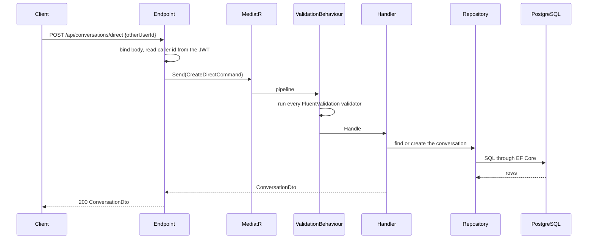

# Request flow

How a REST request travels through the API, from the network to the database and back.

## The middleware pipeline

Middleware is registered in `Program.cs` in this order. Each one wraps everything registered after it, so the order is a constraint, not a style choice.

| # | Middleware | Job | Why it is here |
|---|---|---|---|
| 0 | Forwarded headers (only when `ForwardedHeaders:KnownNetworks` names a network) | Takes the client address and the scheme from `X-Forwarded-For` and `X-Forwarded-Proto`, only from those networks and for one hop | Before everything that reads the scheme or the client address: HSTS, the https redirect and the rate limiter |
| 1 | Request logging (Serilog) | Writes one line per request when it ends: method, path without the query string, status, duration, user id | First, so the duration covers everything below |
| 2 | Security headers | `X-Content-Type-Options: nosniff`, `X-Frame-Options: DENY`, `Referrer-Policy: no-referrer`, and `Cache-Control: no-store` on API paths | Before the exception handler, so error responses carry the headers too |
| 3 | Exception handler | Turns any thrown exception into a ProblemDetails response | Outermost error handling, so it sees errors from every layer below |
| 4 | HSTS (not in Development) | Tells browsers to use https for a year | |
| 5 | Status code pages | Gives a ProblemDetails body to bare 401, 404, 405 and 415 responses | Sees responses produced by anything below |
| 6 | OpenAPI and Scalar (Development only) | The API document and reference UI | |
| 7 | HTTPS redirection | Redirects http to https | Left out when a proxy is configured: the proxy redirects, and the API only sees plain http |
| 8 | CORS | Answers browser preflight requests and sets CORS headers | Before authentication, so a preflight is not rejected as unauthenticated |
| 9 | Authentication | Reads the JWT and fills `HttpContext.User` | Before the rate limiter, which counts the signed-in person |
| 10 | Rate limiter | Applies the policy an endpoint names | After CORS (preflights are not counted) and authentication; before authorization and the endpoint, so a refused request costs no password or database work |
| 11 | Authorization | Enforces `RequireAuthorization()` and `AllowAnonymous` | |
| 12 | Endpoints and the hub | The matched endpoint, or `/hubs/chat` | |

## From endpoint to database

The example is `POST /api/conversations/direct`.

1. **Endpoint.** Binds the JSON body to a small request record, reads the caller's id from the JWT `sub` claim (a request body never says who the caller is), builds a command or query and sends it. A body that cannot be read is rejected by the framework and answered as a 400.
2. **MediatR pipeline.** A tracing behaviour opens a span for the request, and the validation behaviour runs every validator registered for the request type. A failure throws `ValidationException` and the handler never runs. The behaviour is attached to requests that implement `IRequest<TResponse>`, so a command with no result returns `Unit` rather than using the plain `IRequest`, which would skip validation.
3. **Handler.** Holds the logic: authorization against the data (membership, ownership), the rule itself, and the write. Expected failures are thrown as domain exceptions.
4. **Repository.** Translates to EF Core queries, or to hand-written SQL where a plan matters. One `DbContext` per request is the unit of work.
5. **Response.** The handler returns a DTO and the endpoint returns it directly, with no envelope. A list is a bare JSON array.

## Errors

Every error response is `application/problem+json`, whoever produced it. Handlers throw one of a small set of domain exceptions and a single exception handler maps them:

| Exception | Status |
|---|---|
| `ValidationException` (FluentValidation) | 400, with an `errors` map keyed by property |
| `BadHttpRequestException` (unreadable body, bad GUID, missing parameter) | the exception's status, with a deliberately generic `detail` |
| `UnauthorizedException` | 401 |
| `ForbiddenException` | 403 |
| `NotFoundException` | 404 |
| `ConflictException` | 409 |
| `TooManyAttemptsException` | 429, with `Retry-After` |
| anything else | 500, with a generic `detail`; the exception and request are logged at Error |

Domain failures are logged at Warning with the exception type and message, never the request body. The full contract is in [errors](../api/errors.md).

## Hub calls

The hub is authenticated the same way: the token comes from `?access_token=`, which is accepted only on `/hubs/chat`. Hub methods are small and call repositories directly instead of MediatR. A refused hub call is logged once at Warning and reaches the client as a `HubException` with a message that is safe to show. See [real-time design](real-time.md).
