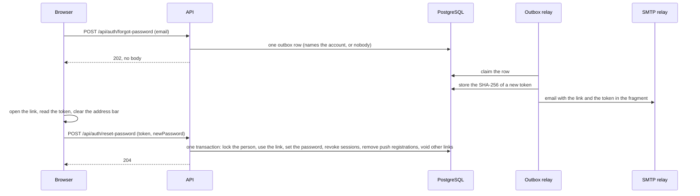

# Account recovery

A person who forgot their password asks for an email with a link, and chooses a new password from it. The server answers the same for every address, so the form cannot be used to find out who has an account.

## Behaviour

- **Asking.** "Forgot password?" on the sign-in page opens a form for an email address. `POST /api/auth/forgot-password` takes `email` and answers `202 Accepted` with no body for every address: one with an account, one without, a deactivated account, and one that is over a limit. The page shows the same confirmation each time.
- **The email.** It is sent within seconds by the outbox relay, as plain text and as HTML, from the address in `Email:From:Address`. It holds a link of the form `{Frontend:Url}/reset-password#token=<token>`. The link works for 30 minutes (`PasswordReset:TokenLifetime`) and once. The email never contains the person's name, and it is always sent to the address stored on the account, whatever was typed.
- **Choosing a password.** The link opens `/reset-password`. The page reads the token from the fragment, removes it from the address bar, and asks for the new password twice. `POST /api/auth/reset-password` takes `token` and `newPassword` (8 to 128 characters, with a digit, a lowercase letter and an uppercase letter) and answers `204`.
- **What a reset does.** In one transaction: the password changes, the security stamp changes, the lockout and the count of failed sign-ins are cleared, every refresh token of the person is revoked (every browser and device), every Web Push registration is removed (an alert carries the start of a message), and every other link that was still waiting is voided. A reset signs nobody in: there is no cookie and no token in the answer, and the person signs in with the new password.
- **In the browser.** After a reset the page asks the server to renew the browser's own session. A refusal means that session belonged to the person whose password changed, so it is ended and the other tabs are told; a renewal means someone else is signed in here, and they stay signed in. The sign-in page then says the password was changed.
- **A link that does not work.** An unknown, used, expired or voided link, and a link for a deactivated account, all give the same `400` ("This link is invalid or has expired.") on the field `Token`. A new password that breaks an account rule gives a `400` on `NewPassword` and leaves the link usable for another try. A link opened in a tab that already shows the reset page replaces the one before it.
- **Email off.** With no `Email:Smtp:Host` the API runs as before, asking for a link answers `503` ("Password reset is not available.") and the page shows that. A link that was sent earlier still works.

## How it works

- Only the SHA-256 hash of a token is stored. Using a link is one conditional `UPDATE` that marks it used and returns the person, so of simultaneous requests with the same link exactly one succeeds.
- The email is made by the relay and not by the request. The request only writes a row, so it takes the same time for every address, and a mail server that is down is retried instead of failing the request.
- The token is in the URL fragment, which a browser never sends to a server, so it is in no request line, proxy log or `Referer` header.
- The transaction locks the person's row before it touches any link. A renewal or a sign-in that is being made at the same moment holds a share lock on that row, so the two take turns and no session survives the revocation, and two links of one person used at once take turns instead of waiting for each other.

## What the server does not reveal

- An address with an account, one without, a deactivated account and a request over the limit all do the same work (look up the address, count it, write one row) and get the same answer.
- The email goes to the stored address, and the count of emails per address uses a keyed hash of the normalised address, so the address is not in Redis.
- Nothing typed by a person is in the email, because the address is not confirmed when an account is created and a display name could otherwise carry someone else's words.
- Logs carry ids and counts only: never an address, a token, a link or a password.

## Endpoints

`POST /api/auth/forgot-password`, `POST /api/auth/reset-password`. See [endpoints](../api/endpoints.md).

## Limits

- Asking for a link: 5 per 15 minutes per client address, and 3 emails per hour per email address. A request over the per-address limit is a `429` with `Retry-After`; one over the per-email limit gets the same `202` and no email. Using a link: 10 per 15 minutes per client address. The counts are in Redis; while it cannot be reached the limits are skipped.
- A request that waits more than 10 minutes to be sent (`PasswordReset:SendWithin`, for example while the mail server is down) is dropped and the person asks again. A mail server that asks to try later is retried; one that refuses for good is not.
- An access token cannot be revoked. One issued before a reset works for up to 15 minutes more, though it cannot be renewed.
- The address is not confirmed when an account is created, so whoever can read the mailbox of an account can reset its password: the account is as safe as its mailbox.
- Someone can use up the three emails an hour of an address they do not own, which delays that person's own request until the hour has passed.
