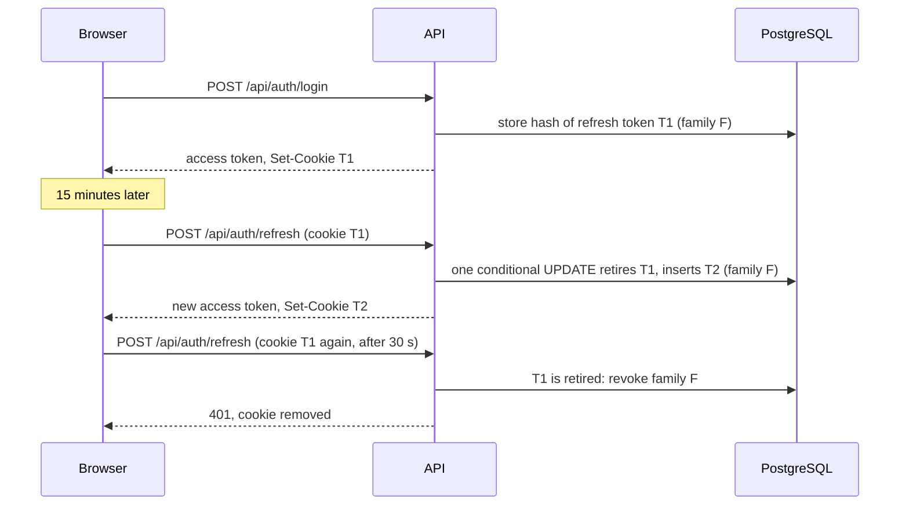

# Accounts and sessions

People register with an email, a handle and a password, and stay signed in through a short-lived access token that renews itself.

## Behaviour

- **Registration** takes `userName` (3 to 50 letters, digits or underscores), `displayName` (1 to 100 characters), `email` (up to 254 characters) and `password` (8 to 128 characters, with a digit, a lowercase letter and an uppercase letter). The handle is what `@mentions` use and never changes; the display name can be changed later.
- **Sign-in** takes email and password. An unknown email and a wrong password give the same 401 text. Five wrong passwords lock the account for 15 minutes (a 429 with `Retry-After`).
- A deactivated account cannot sign in (403) and cannot send messages.
- Both calls answer with the access token, the user's id, handle and display name, and when the token expires, and set the refresh cookie.
- **Renewal.** The access token lives 15 minutes and is kept in memory only. The refresh token is an httpOnly cookie, valid for 14 days from its last use. `POST /api/auth/refresh` exchanges it for a new access token and a new refresh token, and the old refresh token stops working.
- **Sign-out.** `POST /api/auth/logout` revokes every refresh token of that session and removes the cookie.

## How refresh rotation works

- Each refresh retires the presented token and issues the next in the same family. Rotation is one conditional `UPDATE`, so of simultaneous refreshes exactly one wins; the others get a 409 and retry.
- A retired token presented again within 30 seconds is treated as a race between two tabs. After 30 seconds it looks like a stolen copy, so the whole family is revoked.
- Only the SHA-256 hash of a token is stored.
- Refresh and sign-out need the header `X-Requested-With: ChatNET`, in addition to the cookie being `SameSite=Strict`.
- A daily background job removes tokens that expired more than a week ago.

## In the browser

- One session manager renews the access token 60 seconds before it expires, one request at a time, and across tabs through a Web Lock, so several tabs make one refresh.
- Routes wait for the first renewal when the page loads, so a reload restores the session without showing the sign-in page.
- Signing out in one tab signs out the others through a `BroadcastChannel`.
- A tab whose renewal belongs to a different person (someone else signed in on the same host in another tab) signs itself out instead of silently becoming that person.
- An unreachable server never signs anyone out.
- The hub connection closes when its token expires and reconnects with a renewed one.

## Endpoints

`POST /api/auth/register`, `POST /api/auth/login`, `POST /api/auth/refresh`, `POST /api/auth/logout`. See [endpoints](../api/endpoints.md).

## Limits

- Sign-in and registration are limited to 10 per minute per client address; refresh and sign-out to 60 per minute per address, counted separately.
- Only one person can be signed in per browser host, because the refresh cookie is per host. To try two users at once, open the app from two different host names (`localhost` and `127.0.0.1`).
- There is no email confirmation. A forgotten password is recovered by email: see [account recovery](account-recovery.md).
- An access token cannot be revoked before it expires; a deactivated user's token works for up to 15 minutes, though they cannot renew it.
