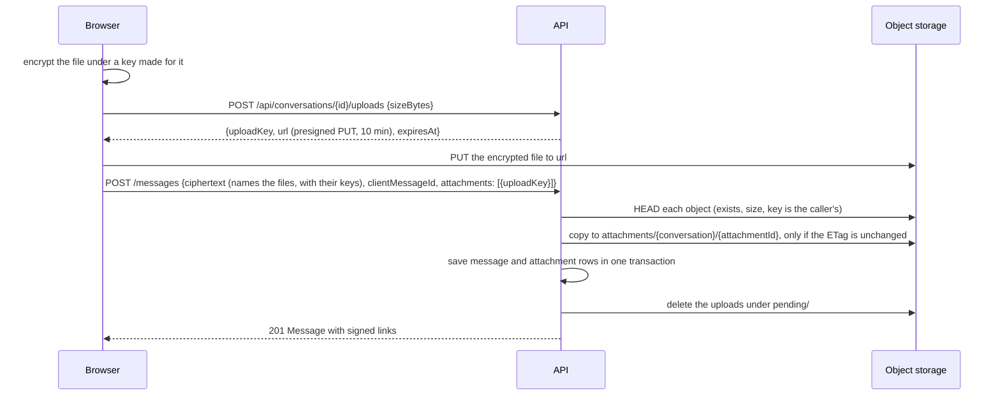

# File attachments

A message can carry up to 4 files of up to 100 MiB each. Every file is encrypted in the sender's browser before it is uploaded, so object storage holds bytes that only the members of the conversation can open. Files go straight from the browser to object storage; the API signs links and checks what was stored, but never receives the bytes and cannot read them.

## What the server knows

The server stores a file as bytes it cannot open. It knows how large each stored file is, how many files a message has, who sent them and when. It does not know a file's name, its type or its content, and it does not see the key: the name, type, size and key of every file are inside the sealed message, next to its text (see [messaging](messaging.md)). Because it cannot see what a file is, it enforces size and count only. The format of an encrypted file and of the entry in the message is in the [encryption formats](../architecture/encryption-format.md#file).

## The upload flow

1. **Encrypt.** The browser makes a random key for the file, cuts the file into pieces of 64 KiB and encrypts each piece with AES-256-GCM. The result is slightly larger than the file: a 13-byte header and a 16-byte tag for every piece.
2. **Ticket.** The caller must be an active member of a non-deactivated account. The request carries one number, the size of the encrypted file. The ticket checks it and returns a presigned PUT that lasts 10 minutes and accepts exactly the content type `application/octet-stream`, whatever the file is. The `uploadKey` is `pending/{conversationId}/{userId}/{guid}`; nothing is stored yet, so the answer is a 200.
3. **Upload.** The browser PUTs the encrypted file directly to the bucket and shows progress; removing the chip cancels the upload. The file is read and encrypted a slice of pieces (about 4 MiB) at a time into a `Blob`, and the `Blob` is what is sent, so a file of 100 MiB is never held whole in the page's memory.
4. **Send.** The message's sealed text carries one entry for each file, in order: name, type, size, key and chunk size. The request names the uploads by key and says nothing else about them. A presigned PUT cannot enforce size, so the send re-checks every named object: the key carries the caller's own conversation and user id (so someone else's upload cannot be attached), the object exists, and its size is within the bounds below. A foreign key, a missing object and a changed one get the same answer. Each file is then copied inside the bucket, only if its ETag is still the one that was checked, to `attachments/{conversationId}/{attachmentId}`. The message and its attachment rows are saved in one transaction, and the uploads under `pending/` are removed (or expire by the bucket's lifecycle rule). Whatever fails after copies exist removes them.

### Size bounds

`Storage:MaxFileBytes` is the largest file as a person sees it, before encryption (100 MiB). The server accepts a stored file of at least 29 bytes (the header and the tag of one empty piece) and at most what a file of that largest size becomes at 64 KiB pieces: 104,883,213 bytes for 100 MiB. A client that chooses smaller pieces makes its own file larger and so can store less, never more.

## What a file is allowed to be

The browser offers and accepts JPEG, PNG, GIF and WebP images, MP4 and WebM video, PDF, plain text and ZIP. This is a rule of the web client alone. The server cannot check it, so a different client could send any bytes, and every reader decides for itself what to do with what a sender says a file is.

## Reading files

- The table stores keys and sizes, never links, names or types. Every response, push and history page signs links for the reader (valid 60 minutes), from one query per page. A link is a plain signed GET with no content type or download name.
- A message's attachments are `{ id, sizeBytes, url }`. What each file is comes from the sealed message: the n-th attachment, in the order the files were attached, is described by the n-th entry of the message. A reader accepts the pairing only when the size an encrypted file of that entry would have is the stored size. An attachment the message does not vouch for (no entry, another size, a message that could not be opened) is shown as a file that can't be opened and is never drawn or saved.
- `GET /api/attachments/{id}/url` returns a new link `{ url, expiresAt }` under the rule that decides who can read the message: member, inside their join window, message not deleted. Every refusal is one 404.

## In the browser

A paperclip and paste add files. Chips show progress. The browser refuses a type or size it would not send before it encrypts anything.

- **Pictures** (PNG, JPEG, GIF, WebP) up to 10 MiB are fetched, decrypted and drawn in the message as they come near the screen. A larger picture is not drawn there: it shows its name and size, and is fetched only when it is opened. A click on either opens the picture in the viewer.
- **Videos** (MP4, WebM) show their name and size; a click opens the video in the viewer.
- **PDFs** show their name and size; a click opens the PDF in the viewer.
- **Any other file** shows its name and size; a click decrypts it and saves it under its name.
- **A fetch that fails** is tried once more with a new link, since the one in the message may have expired, and then says so and offers to try again. A file that is not the one the message describes, or that has been changed in the bucket, is refused: nothing is drawn or saved, and the file says it could not be loaded, with a way to try again.
- **What a sender says is not trusted.** A name is cut to its last path part, with control and invisible characters removed and at most 255 characters. Only the image, video and PDF types above are given a type that the app shows; SVG is never drawn, and everything else is saved as opaque bytes, so a file that says it is a web page is never opened as one. A file that says it is a PDF is read by pdf.js, which refuses what is not one; the address of the decrypted file goes to pdf.js and nowhere else, never to a frame or a link, which would hand it to the browser's own viewer.
- **Memory.** A file is fetched as a `Blob` and decrypted a slice of pieces at a time, so the page never holds a whole large file in its own memory. Files that were opened and are not being shown are kept up to 64 MiB, newest first, so that showing one again does not fetch it again.

### The viewer

A picture, a PDF or a video opens full screen on a dark background. The viewer is loaded the first time a file is opened, and the PDF part, with pdf.js, the first time a PDF is. The picture viewer is described first, then the PDF viewer and the video viewer.

A picture is fitted to the screen (one smaller than the screen is shown at its own size, not enlarged).

- **Zoom** from the fit up to four times the picture's own size: the mouse wheel, a pinch, the buttons (zoom out, actual size, zoom in, fit to screen) or the keys `+`, `-`, `1` (actual size) and `0` (fit). A double click or a double tap goes from the fit to actual size at that point, and back.
- **Move** a zoomed picture by dragging it; it cannot be dragged off the screen.
- **Next and previous** with the arrow keys, the buttons, or a sideways swipe on a picture that is not zoomed. They go through the pictures, the PDFs and the videos of the messages loaded in the conversation, oldest first, and stop at either end; the position is shown ("3 of 12"). Only files the sealed message describes are included, and nothing from a deleted message. If the file that is open is deleted, the viewer moves to the nearest one, or closes when there is none.
- **Download** saves the file under its name as opaque bytes, as the chip does. **Escape** or the close button closes the viewer and returns focus to what opened it.
- A picture that cannot be fetched, or that the browser cannot draw, says so and offers Download (and a retry for a failed fetch).

### PDFs in the viewer

The pages of a PDF are drawn to canvas by pdf.js, in a column that scrolls. The file is read in pdf.js's own worker from the decrypted file, so its bytes do not pass through the page.

- **Pages** are drawn when they come within a screen of the view and let go of when they are further, so a long document holds only a handful of canvases. Each page has its box from the start, so the column is as long as it will be.
- **The toolbar** shows the page the middle of the view is on ("Page 3 of 12"), takes a page number to go to, zooms out and in, and fits to the width. The document opens fitted to the width. The zoom goes from 19% to 375%, where 100% is 96 pixels to the inch. The keys `+`, `-` and `0` (fit to width) and ctrl or cmd with the wheel zoom as well, and a zoom keeps the part of the document at the top of the view where it was. Space, page up and down, home, end and the up and down arrow keys scroll the column. The left and right arrow keys still go to the previous and next file.
- **On a touch screen** the zoom is the buttons. The browser's own pinch scales the whole screen, the toolbar included.
- **What a PDF can do here is small.** There is no text layer, so text cannot be selected or searched, no links or forms, no scripting and no XFA. Nothing in the file runs.
- **A PDF that asks for a password** is not opened ("protected by a password"), and offers Download. A file that is not a PDF, or that cannot be read, says so and offers Download too, with a retry when the fetch failed.
- **Fonts and images.** The character maps for fonts that are not in the PDF (mostly Chinese, Japanese and Korean ones) and the decoders for JPEG 2000, JBIG2 and ICC colour images are files of this site, fetched only when a PDF needs them. The 14 standard fonts are not shipped, so a PDF that uses one without embedding it is drawn in a font of the system.

### Videos in the viewer

A video is played from the encrypted file a range at a time, so it starts, and can be moved about in, without the whole file being fetched and decrypted first. This is done by the service worker of the application (see [web push](web-push.md), which uses the same worker for alerts): the page tells it which file the video is and the key that opens it, the video element asks `/file-stream/<id>` for the bytes it wants, and the worker fetches only the chunks of the stored file that hold them, opens each with its key, and answers with the bytes. Nothing is answered that did not authenticate (a changed byte, a file cut short or of another size, another key, or a bucket that does not honour a range is an error, not a few wrong frames), an answer holds at most 2 MiB so a request for "to the end" does not open the whole video, and answers are marked not to be kept. The key is in the worker's memory only. When the browser stops an idle worker and it loses the stream, it asks the page for the stream again; when the link to the bucket has expired it asks the page for a new one, once.

In a measured case (a video of 60 MiB, whose picture data was a small part of it) opening it, playing it through and moving about in it read about 2.4 MB from the bucket.

Where no worker controls the page (a browser without service workers, one that refused to register it, or a page that was loaded past it with a hard reload), or the stream fails before the video has loaded, the whole file is decrypted and played instead, once.

- **Controls** are the viewer's own, over a video without the browser's: play and pause, a seek bar that shows how much is loaded, the time, mute and volume (the volume slider is left out on a narrow screen), the speed (0.5, 1, 1.25, 1.5 and 2) and full screen. They go away three seconds after the last movement while the video plays. A click on the video plays or pauses it, a double click is full screen. A video whose length is not known (a recording that was never finished) plays but cannot be moved about in.
- **Keys:** Space or `K` play and pause, `J` and `L` go ten seconds back and forward, `M` mutes and `F` is full screen. The left and right arrow keys stay with the viewer (the previous and next file), except on the seek bar and the volume slider, where they are the slider's.
- **A video that cannot be played** says so and offers Download and a retry.

## Editing

An edit seals the message again, so it carries the entries of the message's files again and the files stay readable. A message with a file that can't be opened has no entry to carry, so it cannot be edited.

## Deleting

A deleted message's files are removed through the outbox job `MessageFilesRemoved`, retried until the bucket accepts it. A file that is already gone counts as removed.

## Configuration

`Storage:MaxFileBytes` (100 MiB), `Storage:MaxFilesPerMessage` (4), `Storage:UploadUrlMinutes` (10), `Storage:DownloadUrlMinutes` (60). See [configuration](../operations/configuration.md).

## Limits

- A ticket holder can park a file under `pending/` until the send looks at it or the lifecycle rule removes it (a day).
- Upload tickets are limited to 60 per hour per person.
- The server, and the storage, see the size of each file and the times it is fetched, from which address. A file's size can say something about what it is.
- A member can send a file whose bytes are not what the entry in the message says; readers refuse it and show that it could not be loaded. The server cannot tell.
- No virus scan (the server cannot read the bytes), no thumbnails, and files are served from the storage host, not a separate origin. The encrypted bytes are not usable without a key, and the key is inside a message that only members can open.
- The browser fetches the files itself, so the bucket needs a CORS rule that allows `PUT`, `GET` and `HEAD` from the app's origin and exposes the `ETag` header, and a lifecycle rule that expires `pending/` after a day; both are in `docker/storage` (`cors.json`, `lifecycle.json`).
