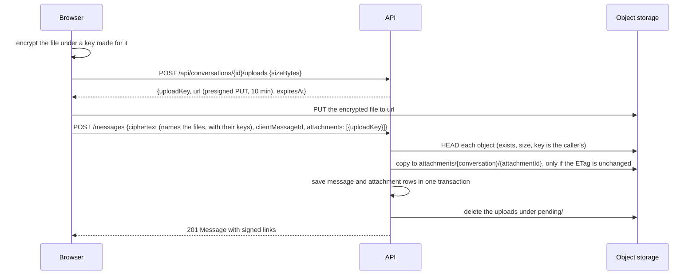

# File attachments

A message can carry up to 4 files of up to 10 MiB each. Every file is encrypted in the sender's browser before it is uploaded, so object storage holds bytes that only the members of the conversation can open. Files go straight from the browser to object storage; the API signs links and checks what was stored, but never receives the bytes and cannot read them.

## What the server knows

The server stores a file as bytes it cannot open. It knows how large each stored file is, how many files a message has, who sent them and when. It does not know a file's name, its type or its content, and it does not see the key: the name, type, size and key of every file are inside the sealed message, next to its text (see [messaging](messaging.md)). Because it cannot see what a file is, it enforces size and count only. The format of an encrypted file and of the entry in the message is in the [encryption formats](../architecture/encryption-format.md#file).

## The upload flow

1. **Encrypt.** The browser makes a random key for the file, cuts the file into pieces of 64 KiB and encrypts each piece with AES-256-GCM. The result is slightly larger than the file: a 13-byte header and a 16-byte tag for every piece.
2. **Ticket.** The caller must be an active member of a non-deactivated account. The request carries one number, the size of the encrypted file. The ticket checks it and returns a presigned PUT that lasts 10 minutes and accepts exactly the content type `application/octet-stream`, whatever the file is. The `uploadKey` is `pending/{conversationId}/{userId}/{guid}`; nothing is stored yet, so the answer is a 200.
3. **Upload.** The browser PUTs the encrypted file directly to the bucket and shows progress; removing the chip cancels the upload.
4. **Send.** The message's sealed text carries one entry for each file, in order: name, type, size, key and chunk size. The request names the uploads by key and says nothing else about them. A presigned PUT cannot enforce size, so the send re-checks every named object: the key carries the caller's own conversation and user id (so someone else's upload cannot be attached), the object exists, and its size is within the bounds below. A foreign key, a missing object and a changed one get the same answer. Each file is then copied inside the bucket, only if its ETag is still the one that was checked, to `attachments/{conversationId}/{attachmentId}`. The message and its attachment rows are saved in one transaction, and the uploads under `pending/` are removed (or expire by the bucket's lifecycle rule). Whatever fails after copies exist removes them.

### Size bounds

`Storage:MaxFileBytes` is the largest file as a person sees it, before encryption (10 MiB). The server accepts a stored file of at least 29 bytes (the header and the tag of one empty piece) and at most what a file of that largest size becomes at 64 KiB pieces: 10,488,333 bytes for 10 MiB. A client that chooses smaller pieces makes its own file larger and so can store less, never more.

## What a file is allowed to be

The browser offers and accepts JPEG, PNG, GIF and WebP images, MP4 and WebM video, PDF, plain text and ZIP. This is a rule of the web client alone. The server cannot check it, so a different client could send any bytes, and every reader decides for itself what to do with what a sender says a file is.

## Reading files

- The table stores keys and sizes, never links, names or types. Every response, push and history page signs links for the reader (valid 60 minutes), from one query per page. A link is a plain signed GET with no content type or download name.
- A message's attachments are `{ id, sizeBytes, url }`. What each file is comes from the sealed message: the n-th attachment, in the order the files were attached, is described by the n-th entry of the message. A reader accepts the pairing only when the size an encrypted file of that entry would have is the stored size. An attachment the message does not vouch for (no entry, another size, a message that could not be opened) is shown as a file that can't be opened and is never drawn or saved.
- `GET /api/attachments/{id}/url` returns a new link `{ url, expiresAt }` under the rule that decides who can read the message: member, inside their join window, message not deleted. Every refusal is one 404.

## In the browser

A paperclip and paste add files. Chips show progress. The browser refuses a type or size it would not send before it encrypts anything.

- **Pictures** (PNG, JPEG, GIF, WebP) are fetched, decrypted and drawn in the message as they come near the screen. A click opens the picture on its own.
- **Videos** (MP4, WebM) show a play button; a click fetches, decrypts and plays the video in place.
- **Any other file** shows its name and size; a click decrypts it and saves it under its name.
- **A fetch that fails** is tried once more with a new link, since the one in the message may have expired, and then says so and offers to try again. A file that is not the one the message describes, or that has been changed in the bucket, is refused: nothing is drawn or saved, and the file says it could not be loaded, with a way to try again.
- **What a sender says is not trusted.** A name is cut to its last path part, with control and invisible characters removed and at most 255 characters. Only the image and video types above are given a type that a browser draws or plays; SVG is never drawn, and everything else is saved as opaque bytes, so a file that says it is a web page is never opened as one.
- **Memory.** A file is fetched and decrypted whole, so it is held in memory while it is shown. The format allows reading by piece for a later reader.

## Editing

An edit seals the message again, so it carries the entries of the message's files again and the files stay readable. A message with a file that can't be opened has no entry to carry, so it cannot be edited.

## Deleting

A deleted message's files are removed through the outbox job `MessageFilesRemoved`, retried until the bucket accepts it. A file that is already gone counts as removed.

## Configuration

`Storage:MaxFileBytes` (10 MiB), `Storage:MaxFilesPerMessage` (4), `Storage:UploadUrlMinutes` (10), `Storage:DownloadUrlMinutes` (60). See [configuration](../operations/configuration.md).

## Limits

- A ticket holder can park a file under `pending/` until the send looks at it or the lifecycle rule removes it (a day).
- Upload tickets are limited to 60 per hour per person.
- The server, and the storage, see the size of each file and the times it is fetched, from which address. A file's size can say something about what it is.
- A member can send a file whose bytes are not what the entry in the message says; readers refuse it and show that it could not be loaded. The server cannot tell.
- No virus scan (the server cannot read the bytes), no thumbnails, and files are served from the storage host, not a separate origin. The encrypted bytes are not usable without a key, and the key is inside a message that only members can open.
- The browser fetches the files itself, so the bucket needs a CORS rule that allows `PUT`, `GET` and `HEAD` from the app's origin and exposes the `ETag` header, and a lifecycle rule that expires `pending/` after a day; both are in `docker/storage` (`cors.json`, `lifecycle.json`).
