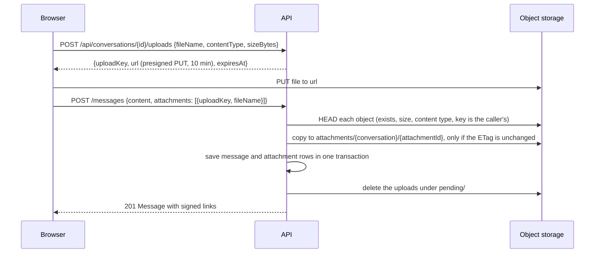

# File attachments

A message can carry up to 4 files of up to 10 MB each. Files go straight from the browser to object storage; the API signs links and checks what was stored, but never receives the bytes.

## Allowed files

JPEG, PNG, GIF, WebP images; MP4 and WebM video; PDF; plain text; ZIP. The list is `Storage:AllowedContentTypes`. There is no SVG, HTML, script or executable type.

## The upload flow

1. **Ticket.** The caller must be an active member of a non-deactivated account. The ticket checks the declared type and size and returns a presigned PUT that lasts 10 minutes and accepts exactly that content type. The `uploadKey` is `pending/{conversationId}/{userId}/{guid}`; nothing is stored yet, so the answer is a 200.
2. **Upload.** The browser PUTs the file directly to the bucket and shows progress; removing the chip cancels the upload.
3. **Send.** A presigned PUT cannot enforce size or inspect content, so the send re-checks every named object: the key carries the caller's own conversation and user id (so someone else's upload cannot be attached), the object exists, its size is between 1 byte and the limit, and its stored content type is on the list. A foreign key, a missing object and a changed one get the same answer. Each file is then copied inside the bucket, only if its ETag is still the one that was checked, to `attachments/{conversationId}/{attachmentId}`. The message and its attachment rows are saved in one transaction, and the uploads under `pending/` are removed (or expire by the bucket's lifecycle rule). Whatever fails after copies exist removes them.

## Reading files

- The table stores keys. Every response, push and history page signs links for the reader (valid 60 minutes), from one query per page.
- Images and videos are served inline; any other file is served with `Content-Disposition: attachment`.
- `GET /api/attachments/{id}/url` returns a new link `{ url, expiresAt }` under the rule that decides who can read the message: member, inside their join window, message not deleted. Every refusal is one 404.
- The browser renews a dead link once and puts the new link into the message.

## In the browser

A paperclip and paste add files. Chips show progress. Images show in a grid and other files as file chips. Client-side checks refuse a type or size the server would refuse.

## Deleting

A deleted message's files are removed through the outbox job `MessageFilesRemoved`, retried until the bucket accepts it. A file that is already gone counts as removed.

## Configuration

`Storage:MaxFileBytes` (10 MB), `Storage:MaxFilesPerMessage` (4), `Storage:AllowedContentTypes`, `Storage:UploadUrlMinutes` (10), `Storage:DownloadUrlMinutes` (60). See [configuration](../operations/configuration.md).

## Limits

- A ticket holder can park a file under `pending/` until the send looks at it or the lifecycle rule removes it (a day).
- Upload tickets are limited to 60 per hour per person.
- No virus scan, no thumbnails, and files are served from the storage host, not a separate origin.
- The bucket needs CORS rules that allow PUT and GET from the app's origin, and a lifecycle rule for `pending/`; the setup is in `docker/storage`.
