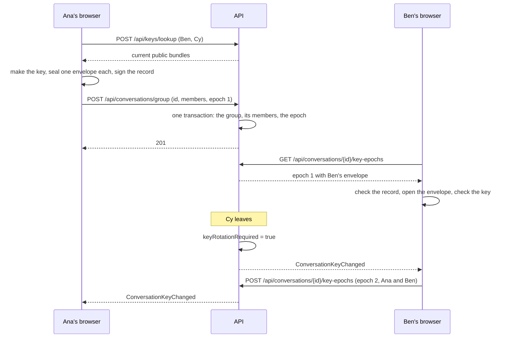

# Conversation keys

Every conversation has a key for each period of its life, called an **epoch**. A member's browser makes the key of an epoch, seals it once for each member with that member's public key, and sends the sealed copies (**envelopes**) to the server, which stores and hands them out and can open none of them. A new epoch begins when people join, and one is due when someone leaves, so a person who left cannot read what comes after and a person who joined cannot read what came before. The [encryption formats](../architecture/encryption-format.md) specify the bytes, and [encryption keys and devices](encryption-keys.md) covers the keys each person holds.

This page covers how the keys of a conversation are made, delivered and checked. The text of every message is sealed under the key of the epoch it is sent in (see [messaging](messaging.md)); files are not sealed with them.

## Behaviour

- **A new conversation.** The browser of the person who starts it chooses the id of the conversation, makes the first key (epoch 1), seals it for every person in the conversation, signs a record of who it was made for, and sends all of that with the request: `POST /api/conversations/direct` and `POST /api/conversations/group` take an `id` and an `epoch`. The conversation and its first epoch are saved in one transaction, so there is no conversation without a key. Asking for a direct chat that already exists returns it and ignores both the id and the epoch.
- **People joining.** `POST /api/conversations/{id}/members` takes a new epoch made for the people in the group now and the people being added. It is saved in the same transaction as their joining. A person who joins for the first time holds an envelope for that epoch and for none before it, which is how they are kept from reading what came before. Someone who comes back after leaving is added the same way, and also keeps the epochs they were in before they left: they could read those then, and the server still shows them only what was said from their new join.
- **People leaving.** Removing a member or leaving a group changes nothing about the keys except to mark the epoch in force as due for replacement: the conversation reports `keyRotationRequired: true`. The request carries no epoch, because the person who is leaving has no part in the next key. The next member to open the conversation makes it, for the people who remain.
- **Making a key.** Any member can store the next epoch with `POST /api/conversations/{id}/key-epochs`, whatever their role. A replacement that nothing asks for waits: while the newest epoch is less than a day old, an epoch stored this way is refused with `epoch-too-soon`, unless the conversation has no epoch yet or a removal or a leave marked the one in force as due. A member who finds the epoch in force unusable can replace it once it is a day old. Creating a conversation and adding people carry their own epoch and are never held back. Several members may store an epoch together after a change: the server stores one and refuses the others as out of date, and they take the one that was stored.
- **Opening a conversation.** A browser makes a conversation ready as it is opened: if the epoch in force is current and its key is held, nothing is asked of the server. If this browser has not read the epoch yet, it fetches it, checks it and opens its own envelope. If the conversation has no epoch (it existed before keys did, so it is at epoch 0) or its epoch is due for replacement, it makes the next one, provided everyone in the conversation has set up encryption. Nothing is shown to the person while this happens, and a failure is tried again the next time the conversation is opened.
- **People without keys.** A key cannot be sealed for a person who has not set up encryption. Starting a conversation with such a person, or adding them, is refused and the screen names them. In an existing conversation their lack of keys keeps the next epoch from being made until they set it up or are removed; until then nothing can be sent in it, the server refuses a message with `epoch-stale`, and the box where a message is written says who the conversation is waiting for.
- **Messages follow the epoch.** A message is stored only under the epoch in force, and only while that epoch is not due for replacement: otherwise the server answers `409` with `epoch-stale` or `epoch-due`, and the browser looks at the keys again, makes or reads the epoch, and seals the message once more. Removing a person or leaving therefore does not stop anyone from writing for good: the next message from a member's browser replaces the epoch first, and what is sent after a removal is sealed under a key the removed person never holds.
- **Reading keys.** `GET /api/conversations/{id}/key-epochs` returns the epochs the caller has an envelope for, oldest first, in pages. Each carries the caller's own envelope, who the epoch was made for and the creator's signature. Someone who left can still ask: they keep the keys of the epochs they were in.
- **Public keys.** A browser gets the current public bundle of each person it will seal a key for with `POST /api/keys/lookup`.
- **Before the chat.** After signing in, a browser that does not hold the person's keys shows a screen in place of the chat, because every conversation is sealed to them. It sets the keys up, restores them from the backup or links this browser from another device. See [encryption keys and devices](encryption-keys.md).
- **Signing out** deletes the keys of conversations and the remembered identities of other people from the browser, along with the keys of the device. So does finding out that this device was removed from another device.

## What a browser checks

A key is used only after the browser has checked the epoch it came in:

1. The creator is one of the people the epoch was made for, and so is the person checking, at the generation of key their envelope is sealed to.
2. The creator's signature is valid over exactly that record: the conversation, the epoch number, the creator, the commitment to the key and the list of people with their key generations.
3. The creator's identity key is the one this browser first saw for them. A different one is refused (see below).
4. The envelope opens with the person's own key of that generation.
5. The key inside matches the commitment, so a creator cannot have given different members different keys under one signature.
6. For the newest epoch, the people it was made for are the people in the conversation now.

An epoch that fails a check is not kept, and the ones after it are still read. Before sealing a key to someone, the browser checks their bundle in the same way: it is signed by its own identity key, says the generation the server stated, and carries the identity key first seen for that person. The person's own bundle must be the one the browser holds.

**Remembering people.** The first time a person's identity key is seen it is kept in the browser. From then on a different key for the same person is refused until the person looking accepts it, because a public key that changes without anyone having reset their encryption is the server, or someone with access to it, putting itself between two people.

## What the server checks

The server cannot open an envelope or check a signature. It insists on the shape and on completeness, while holding the same per-conversation lock as every change of membership:

- The epoch is the next number: the newest plus one. Otherwise `409` with the code `epoch-stale`.
- Every person in the conversation has a key, otherwise `409` with `member-has-no-keys`.
- There is an envelope for exactly the people in the conversation and for nobody else, each sealed to the newest key generation that person has. Otherwise `409` with `epoch-members-changed`.
- An epoch stored on its own is not a replacement nobody asked for: the conversation has no epoch yet, or the one in force is marked as due, or it was made at least a day ago. Otherwise `409` with `epoch-too-soon`. This is checked after the three above, so a member who lost a race hears that the epoch is out of date.
- The commitment is 32 bytes, the signature 64 and each envelope 94 bytes of the right version, a person is named once, and at most 101 envelopes are sent. Otherwise `400`.
- The caller is a member for storing an epoch, and a member or someone who was one for reading them. A conversation that does not exist and one the caller is not in give the same `403`.

A refused epoch changes nothing: a group is not created, nobody is added and nothing is saved. The `code` of a `409` is in [errors](../api/errors.md#conflict-codes).

## What the server stores

| Stored | What it is | What the server can do with it |
|---|---|---|
| Epochs | The number, who made it and when, why (the first key of a conversation, people joining, or a replacement), the commitment to the key and the creator's signature | Hand them to the members. It checks the number and the sizes |
| Envelopes | One per member per epoch: the key sealed to the member's public key, and the key generation it was sealed to | Hand each member their own, and no one else's. It cannot open one |
| The conversation | The newest epoch and whether it is due for replacement | Refuse an epoch that is not the next, and tell the members |

The people an epoch was made for are the people it has an envelope for. The tables are in the [data model](../architecture/data-model.md).

## Endpoints and events

| Endpoint | Purpose |
|---|---|
| `POST /api/keys/lookup` | The current public bundles of the people named (up to 101); people without keys are left out |
| `POST /api/conversations/direct`, `POST /api/conversations/group` | Create a conversation with its id and first epoch |
| `POST /api/conversations/{id}/members` | Add people with the new epoch |
| `GET /api/conversations/{id}/key-epochs` | The epochs the caller has an envelope for (`from`, `limit`; up to 50 a page) |
| `POST /api/conversations/{id}/key-epochs` | Store the next epoch |

A conversation carries `keyEpoch` (0 while it has none) and `keyRotationRequired`. `ConversationKeyChanged { conversationId, keyEpoch, keyRotationRequired }` is pushed to the people in the conversation when an epoch is stored or someone leaves; it carries the state when it is sent, so a client applies it only when its epoch is not lower than the one it holds, and within one epoch the need to replace it only turns on. See [endpoints](../api/endpoints.md) and [real-time events](../api/realtime-events.md).

## Limits

- The server decides who is in a conversation, and it checks that each epoch covers them. It cannot make an epoch itself, but it can withhold epochs or serve an old one, and it can give a wrong public key the first time a person is seen. Nothing in the app yet lets two people compare keys outside it.
- Keys are not replaced on a timer, only when the membership changes or a member replaces them, and a member can do that at most once a day unless a removal or a leave marked them as due. A key that has been in force a long time protects everything sent under it if it is ever exposed.
- A member who stores an epoch that the others cannot use can keep the conversation on it for up to a day, or until that member is removed, which marks it as due.
- A person who has not set up encryption keeps a conversation from getting new keys until they set it up or are removed.
- Every change of membership adds an epoch and none are deleted; a group of 101 people stores up to 101 envelopes for each epoch.
- These endpoints share the limit of the other key endpoints: 60 requests per minute per person.
- Logs carry ids and sizes only, never an envelope, a commitment or a key.
