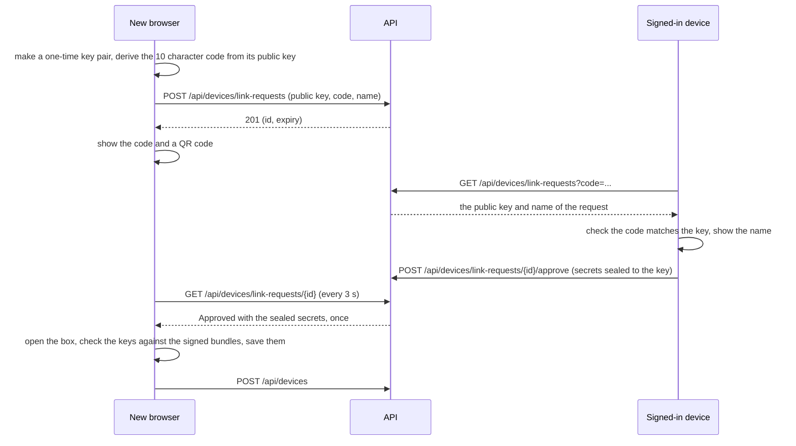

# Encryption keys and devices

A person has encryption keys that are made in their browser, backed up under a passphrase only they know, and handed from one of their devices to another. The server stores the public half of the keys, the encrypted backup and the list of devices, and can open none of the private material. The [encryption formats](../architecture/encryption-format.md) specify the bytes.

This page covers the keys and the devices that hold them. Message text and files are still sent and stored as before; protecting them with these keys is a separate step.

## Behaviour

- **Setting up.** The profile has an Encryption keys section. A person who has no keys chooses a recovery passphrase of at least 12 characters, typed twice. The browser makes an identity key (signs) and an account key (receives), signs the public half, encrypts the private halves under a key stretched from the passphrase, and sends both in one request: `POST /api/keys/me` answers `201` with the bundle and the backup version. It then adds itself as a device with `POST /api/devices`. A second set-up is a `409`.
- **On a new browser.** After signing in, the profile says the keys are not on this browser. There are two ways to get them.
  - **The passphrase.** `GET /api/keys/me/backup` returns the encrypted backup, which the browser opens with the passphrase. The browser checks the keys it opened against the signed bundles the server holds, for every generation, and only then saves them and adds itself as a device. A wrong passphrase and a damaged backup look the same: the backup does not open.
  - **Another device.** The new browser shows a link code of 10 characters (`XXXXX-XXXXX`) and a QR code. On a device that is signed in, the person types the code under Link code. That device finds the request, checks the code against the key the server returned, shows which device is asking, and on approval sends the secrets of the person sealed to the one-time key of the new browser. The new browser asks every 3 seconds and gets the sealed secrets once.
- **Changing the passphrase.** A new backup of the same keys under a new passphrase replaces the old one. It is made from the version the device last read, so two devices changing it together cannot both win (`409` for the later one).
- **Devices.** The profile lists the devices that hold the keys, with when each was added and last used, and marks the one in use. A device is added when a browser has the keys and removed when the person removes it or signs out on it.
- **Signing out.** Signing out of a browser that holds the keys asks first, because it deletes them from that browser, and says when this is the only device. The browser then removes itself from the server (`DELETE /api/devices/{id}`) and deletes its copy. A session that merely expires keeps the keys, so signing in again finds them.
- **Sessions and devices.** A browser that holds the keys sends the id of its device in the `X-Device-Id` header when it signs in and when it renews its session. The server ties the session to the device if it is one of the person's that has not been removed, and ignores the header otherwise. Removing a device ends every session tied to it and no other, and a session tied to a removed device cannot be renewed.
- **Removed elsewhere.** A browser whose device was removed from another device finds out the next time the profile is opened, deletes its keys and says so.

## How a device is linked

- The code is 50 bits of a hash of the one-time public key. A server that returned a key of its own to the signed-in device would have to find one whose hash starts with the same 50 bits, which cannot be done inside the minutes a request lives, and the device that approves checks.
- The sealed secrets are handed over by one statement that also clears them, so of simultaneous polls exactly one gets them, and they are not kept after that. A request that nobody approves, or whose answer is not collected in time, ends and the sealed secrets are never handed over.
- A request lives 10 minutes (`Encryption:LinkLifetime`). The code is sent in the query string, which the request log leaves out.

## What the server stores

| Stored | What it is | What the server can do with it |
|---|---|---|
| Public bundles | The public keys of each generation of a person's account key, signed by their identity key | Hand them to the person's own devices. It checks the size and version, and that the first generation is generation 1 |
| Key backup | The private keys encrypted under the passphrase, with a version | Return it to its owner. It cannot open it |
| Devices | A name, a kind (Web, Ios or Android), when added and last used, and whether removed | List them and tie sessions to them |
| Link requests | A one-time public key, a code, the name of the asking device and, for a moment, the sealed secrets | Relay the sealed secrets once. It cannot open them |

The tables are in the [data model](../architecture/data-model.md).

## Endpoints

| Endpoint | Purpose |
|---|---|
| `GET /api/keys/me` | The public bundles and the backup version of the caller |
| `POST /api/keys/me` | First set-up: the bundle of generation 1 and the first backup |
| `GET /api/keys/me/backup` | The encrypted backup |
| `PUT /api/keys/me/backup` | Replace the backup from a known version |
| `POST /api/devices`, `GET /api/devices`, `DELETE /api/devices/{id}` | Add, list and remove devices |
| `POST /api/devices/link-requests` | A new device asks to be linked |
| `GET /api/devices/link-requests?code=` | A signed-in device finds a request by its code |
| `GET /api/devices/link-requests/{id}` | The new device asks how its request is doing |
| `POST /api/devices/link-requests/{id}/approve` | Send the sealed secrets |

Every route is the caller's own: the id comes from the token and an id of someone else's gives `404`. See [endpoints](../api/endpoints.md) for payloads and errors.

## Limits

- The backup can be attacked offline by whoever obtains it, by trying passphrases. The key is stretched with 600,000 rounds of PBKDF2, which slows each guess but does not stop a weak passphrase from being found. It is returned only to its owner, and a long passphrase is the protection that matters. Nobody can recover a forgotten passphrase.
- The private keys on a device are kept in the browser's IndexedDB in a form that can be exported, because the backup and linking need them. A script injected into the page could read them while the page is open. Signing out deletes them.
- The server cannot check the signature of a bundle; the clients do, against the identity key they remember.
- Removing a device ends its sessions but does not change the keys: a device that kept a copy still holds them.
- Up to 10 devices per person (`Encryption:MaxDevicesPerUser`), 5 link requests waiting at once (`Encryption:MaxPendingLinkRequests`), a backup of up to 64 KiB (`Encryption:MaxBackupBytes`). These endpoints share one limit of 60 requests per minute per person; a waiting new device uses 20 of them.
- Setting up cannot be done a second time, and there is no way to start over with new keys.
