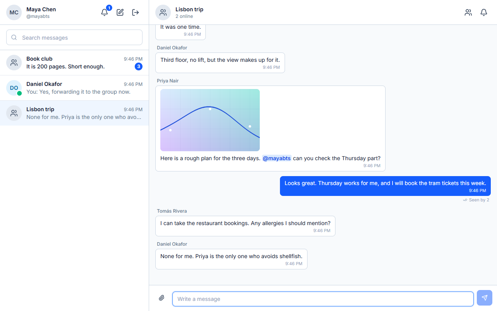

# Messaging and history

## Sending

`POST /api/conversations/{id}/messages` with `{ content, clientMessageId, attachments }`.

- The caller must be an active member and not deactivated.
- `content` is trimmed and at most 4,000 UTF-16 code units. It is required unless the message has attachments; a message of only files has `content: ""`.
- `clientMessageId` is an optional UUID the browser makes up. It is stored and returned everywhere, and it makes the send **idempotent**: a send whose conversation, sender and id are already stored is answered with the stored message, with status 200 instead of 201, and the message is pushed again (the first push may have failed). Two copies arriving together are settled by a unique partial index; the loser answers with the winner's message. A send without an id is not protected.
- `attachments` is up to 4 files named by upload ticket. See [attachments](attachments.md).
- The message and the conversation's `UpdatedAt` are saved in one `SaveChanges`, with an outbox row for the push. The request then pushes `ReceiveMessage` to the conversation's group, including the sender's own tabs, and marks the row. A failing push is logged and does not fail the request; the relay delivers it later.
- Sending moves the sender's read position to the new message.

## History

`GET /api/conversations/{id}/messages` returns at most 50 messages, oldest first, from when the caller joined to when they left (or to now).

| Query | Returns |
|---|---|
| none | the latest 50 |
| `before=<messageId>` | the 50 just older than that message |
| `after=<messageId>` | the 50 just newer |
| `around=<messageId>` | up to 50 older, the message, and up to 50 newer (101 at most) |

A page shorter than 50 is the end in that direction. The cursor is a message id, looked up inside the caller's own window; anything else (unknown, from another conversation, or sent before they joined) is the same 400. History is keyset-paged on `(CreatedAt, Id)`, so it is stable while new messages arrive, and every query reads about 50 rows whether the conversation holds 50 messages or 6,000.

A deleted message comes back with `content: null`, `isDeleted: true` and no attachments. Every message carries its attachments with links signed for this response.

## Ordering

Messages are ordered by `CreatedAt`, set by the server that handled the send, then by `Id`. Messages sent one after another by one client arrive over the socket in order.

## In the browser

- **Optimistic sending.** The message appears at once as "sending" and is confirmed by whichever arrives first, the REST response or the push, matched by `clientMessageId`. A failed send shows Retry and Dismiss; retrying reuses the same id, so it cannot duplicate.
- **Scrolling back.** When the top of the list scrolls into view the page before is loaded, keeping the reader's place.
- **Windows.** A message far back (a search result) is shown by loading the history around it. The store then holds a window that does not reach the newest message; pushes that arrive meanwhile go into a buffer so they do not leave a hole, and join the window when it reaches the newest message. "Jump to latest" or sending drops the window and loads the latest page.
- **Catch-up after a reconnect.** Events sent while the connection was down are lost to that client, so after reconnecting each loaded conversation asks for its latest page. If that page contains the newest message the tab holds, or is short, it is merged: it brings the new messages and the current state of the last messages held, including edits and deletions. Otherwise the client reads `after=<newest id>` page by page until a short page, then looks back over the last messages held with `before=`. Past 10 pages the conversation is dropped and loaded afresh. A page that does not join up with what the store holds is never added, so a hole is never created.

## Endpoints and events

`POST` and `GET /api/conversations/{id}/messages`; hub events `ReceiveMessage` and `MessageUpdated`. See [endpoints](../api/endpoints.md) and [real-time events](../api/realtime-events.md).

## Limits

- The deletion of a message older than the last 50 held, in a tab that was away for more than a page of new messages, shows after a reload.
- Sending is limited to 30 messages per 10 seconds per person.
