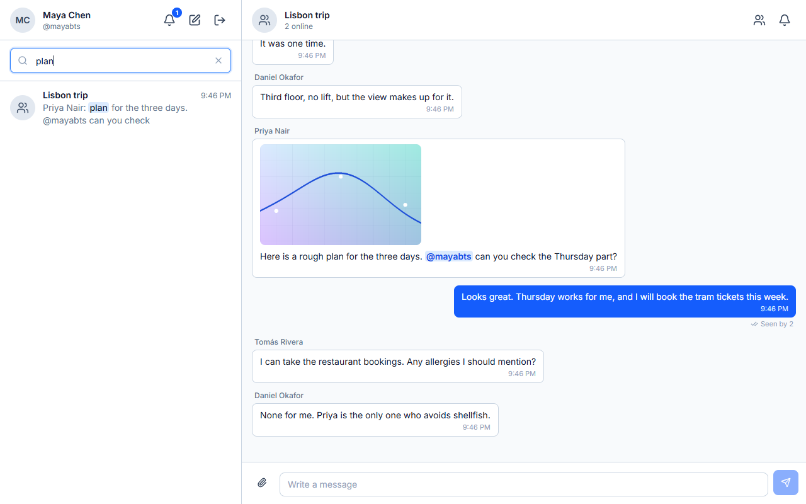

# Message search

A search box above the conversation list finds what was said, in the conversations the person is in and within the time they were in them.

## Behaviour

`GET /api/search/messages?q=&conversationId=&before=`

- Searches the messages the caller may read: their conversations, within each member window (`JoinedAt` to `LeftAt`). Deleted messages are never results.
- Finds a message by its **text** or by the **name of one of its files**. A hit found by text carries a `snippet` (the text around the match as `{ text, match }` pieces) and a null `fileName`; a hit found by a file name has an empty snippet and the `fileName`.
- Results are newest first, 20 per page. `before` is the `messageId` of the last hit of the previous page.
- `conversationId` limits the search to one conversation. Naming one the caller was never in is the 403 every endpoint gives.
- `q` is 2 to 100 characters after trimming.

## Query syntax

| Input | Meaning |
|---|---|
| `meeting notes` | every word must be present, in any order and case |
| `meet` as the last word | matched from its start (`meeting`, `meets`) |
| `"exact phrase"` | the words together |
| `-word` | the word must not be present |
| `a or b` | either word |

A word after a minus or after `or` has to be complete; only the last plain word is a prefix. The query is parsed by Postgres `websearch_to_tsquery`.

## How it stays fast

One query, in two phases per conversation:

1. The newest 300 messages of the window, read in order, for a quick answer from recent chat.
2. If more is needed, the full-text index `IX_Messages_Search` on `(ConversationId, to_tsvector('simple', Content))`.

Plan tests assert how many rows are read after a `VACUUM`. The first version read 16,666 rows for 3 results.

Snippets are made by `ts_headline` for the page only, with markers from the private use area so message text cannot forge a highlight; the browser draws the snippet as text.

## Opening a result

A result opens the conversation at that message, however far back it is, by loading the history around it (`?around=`). Reading on, scrolling to live, or "Jump to latest" work from there. See [messaging](messaging.md).

## People search

The search for people (`GET /api/users?query=`) uses trigram indexes (`pg_trgm`) on handle and display name instead of reading every user.

## Privacy

The text searched for is never written to the log, and the member windows are part of the query in both phases and in the cursor lookup, so a message from a conversation the caller is not in, from before they joined, from after they left, or deleted is never a result. A `before` that is not one of theirs is the same 400 as one that does not exist.

## Limits

- File names are searched only among the newest 300 messages of each window.
- The deep phase relies on the planner choosing the full-text index, which holds after `VACUUM`; keep autovacuum on.
- 30 searches per 10 seconds per person.
