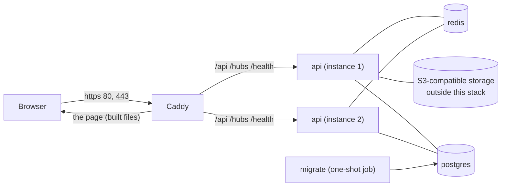

# Deployment

`docker-compose.prod.yml` describes the whole application for **one machine**, for example a small VPS. It is a Compose file for a single host, not an orchestrator: there are no rolling updates and no replication of Postgres or Redis.



## What runs

| Service | Role |
|---|---|
| `caddy` | Serves the built frontend, passes `/api`, `/hubs` and `/health` to the API instances, and obtains and renews the HTTPS certificate. The only service reachable from outside (ports 80, 443 and 443/udp for HTTP/3). The page and the API share one address, so the refresh cookie stays first-party and no CORS is needed. |
| `api` | Two instances by default (`API_REPLICAS`). They share the work and reach each other through Redis, so a message sent through one reaches a browser connected to the other. Caddy finds the instances through DNS every 5 seconds, health-checks them, and keeps each browser on one instance with a cookie (SignalR needs that). |
| `migrate` | A one-shot job that applies the EF Core migrations and exits before the API instances start, so several instances starting together never change the schema at once. |
| `postgres`, `redis` | With passwords, data in volumes, and no published ports. |
| `jaeger` | Only with `--profile tracing`. Its page listens on the machine's loopback address only. |

Start order: Postgres and Redis healthy, then `migrate` finishes, then the API instances become healthy (`/health`), then Caddy.

The API and Caddy containers drop all Linux capabilities and cannot gain new privileges. The API container also has a read-only filesystem and runs as an unprivileged user. Files live in object storage that is **not** part of this stack.

## What you need

- A Linux machine with Docker and the Compose plugin, and ports 80 and 443 open to the internet. x86-64 and ARM64 both work: the images are built for the CPU of the machine that builds them, so the commands are the same on both. Allow enough memory for the build; on a machine with 2 GB of RAM, add swap.
- A domain name whose DNS records point at the machine. Caddy asks for the certificate as soon as it starts, so the records must be right before the first start.
- An S3-compatible bucket (Cloudflare R2, for example) with an access key.

## Prepare the bucket

The bucket needs two things, the same ones `docker/storage/init.sh` applies to the local object store:

1. A **CORS rule** that allows `PUT`, `GET` and `HEAD` from your site's origin and exposes the `ETag` header. The browser uploads and fetches files itself, so `GET` and `PUT` from the site's origin are both required. Start from `docker/storage/cors.json` and replace `AllowedOrigins` with `https://<your domain>`.
2. A **lifecycle rule** that expires objects under `pending/` after one day (`docker/storage/lifecycle.json`), so uploads that were never attached to a message do not stay.

Both are standard S3 API calls (`put-bucket-cors`, `put-bucket-lifecycle-configuration`).

## First start

```bash
git clone <this repository> chatnet && cd chatnet
cp .env.prod.example .env.prod
```

Fill in every value in `.env.prod`; the file explains each one (see also [configuration](configuration.md)). Then:

```bash
docker compose -f docker-compose.prod.yml --env-file .env.prod up -d --build
docker compose -f docker-compose.prod.yml --env-file .env.prod ps
```

The first build takes a few minutes. When `ps` shows the API instances as healthy, open `https://<your domain>`. To follow the API's log (one JSON object per line):

```bash
docker compose -f docker-compose.prod.yml --env-file .env.prod logs -f api
```

## Updating

```bash
git pull
docker compose -f docker-compose.prod.yml --env-file .env.prod up -d --build
```

The migration job runs first and does nothing when the database is already up to date. The API instances are replaced together, so there is a short break while they start. Take a [backup](backups.md) before an update that includes migrations.

**Updating a database that holds messages from before they were sealed.** The migration that makes messages ciphertext deletes every message that exists, with its notifications and the pending pushes about them, because the server holds those in the clear and cannot seal them: only the sender's browser can. It cannot be undone, and rolling the migration back puts the columns back without the data. The files those messages carried are removed from the bucket by the outbox relay once the API runs, one row for each file. Take a dump first if the old messages matter.

**Updating a database that holds files from before they were encrypted.** The migration that encrypts files deletes every message that carries a file, with its notifications and the pending pushes about them, and removes the name, type and kind columns of the attachment table, because the server holds those in the clear and cannot encrypt a file: only the sender's browser can. It cannot be undone, and rolling it back puts the columns back without the data. The stored files are removed from the bucket by the outbox relay once the API runs, one row for each file. Messages with text only are kept.

## Trying it on one machine

Set `DOMAIN=localhost` in `.env.prod`. Caddy then uses its own certificate authority, which a browser does not trust, so the browser warns once; `curl -k https://localhost/health` shows the stack answering. To skip TLS altogether, also set `SITE_ADDRESS=http://localhost`. This stack is named `chatnet-prod`, so it never shares volumes with the development file, whose project name comes from the folder it is in.

## Web Push

Alerts for closed browsers need `PUSH_PUBLIC_KEY`, `PUSH_PRIVATE_KEY` and `PUSH_SUBJECT` in `.env.prod`; the recipe to generate the pair is in `.env.prod.example`. Without them the feature is off and nothing else changes. Changing the pair makes every browser subscribe again, which they do by themselves the next time the page is open. A browser opens the connection to its own vendor's push service, so the API container must reach `fcm.googleapis.com`, `updates.push.services.mozilla.com`, `push.apple.com` and `notify.windows.com` on port 443.

## Email

Password reset needs a mail relay. Without `SMTP_HOST` in `.env.prod` the stack runs as before and asking for a reset link answers 503; links that were sent earlier still work. The variables are listed in `.env.prod.example`. Any SMTP relay works. For Resend:

- Verify the domain you send from at resend.com/domains and add the DNS records it generates (DKIM and SPF); a DMARC record is recommended. It suggests sending from a subdomain such as `auth.<your domain>`.
- Create an API key. Set `SMTP_HOST=smtp.resend.com`, `SMTP_USERNAME=resend`, `SMTP_PASSWORD=<the API key>`, and `MAIL_FROM_ADDRESS` to an address on the verified domain. Port 587 with `StartTls` is the default; port 465 needs `SMTP_SECURITY=SslOnConnect`.
- Keep open and click tracking off for that domain. Resend has them off by default and turns them on per domain. A tracked link goes through the provider's own address and carries the reset token with it.

The API container must reach the relay on its port, outbound. The reset link points at `https://<DOMAIN>/reset-password`. Mail is sent by the outbox relay within a few seconds of the request, and a request that waits more than ten minutes (the relay was down) is dropped.

## Limits

- One Postgres and one Redis, with no replication and no automatic backups.
- The rate limits are counted in Redis. While Redis cannot be reached they are not applied (only the account lockout, in Postgres, still protects a password), and a Redis that loses its data starts the counts again from zero. Behind the proxy, an outage of Redis also takes the API out of the rotation within ten seconds, because `/health` includes Redis.
- Updates are not rolling: the API instances are replaced together.
- The migrations create the Postgres extension `pg_trgm` for the people search. It ships with Postgres and is trusted, so the owner of the database may create it, which works with the Compose Postgres and with a managed one. The index is built inside the migration, which holds writes to the users table while it builds: seconds on a small database, longer on a large one. Keep autovacuum on, which the people search plan relies on.
- The Docker network is trusted as a whole: anything else started on it could claim a client address. `TRUSTED_PROXY_NETWORK` names the network Caddy reaches the API from.
